# Codex da Campanha

Aplicação web self-hosted para acompanhar campanhas de RPG de mesa: **mapa** interativo, **rotas** com pernoite, **rede de relações**, **sessões**, **linha do tempo**, **itens** e **Modo GM** na mesma interface.

**Versão:** 1.4.0 — [`CHANGELOG.md`](CHANGELOG.md)
**Produção (Campaign Codex):** [`docs/runbook-corte-campaign-codex.md`](docs/runbook-corte-campaign-codex.md) — `https://campaign-codex.1nodado.com.br/c/1/wfrp` e `/c/2/wod`

---

## Capturas de ecrã

Capturas da versão **1.0.1** (`frontend-v2`, tema paper-parchment).

### Entrada e exploração

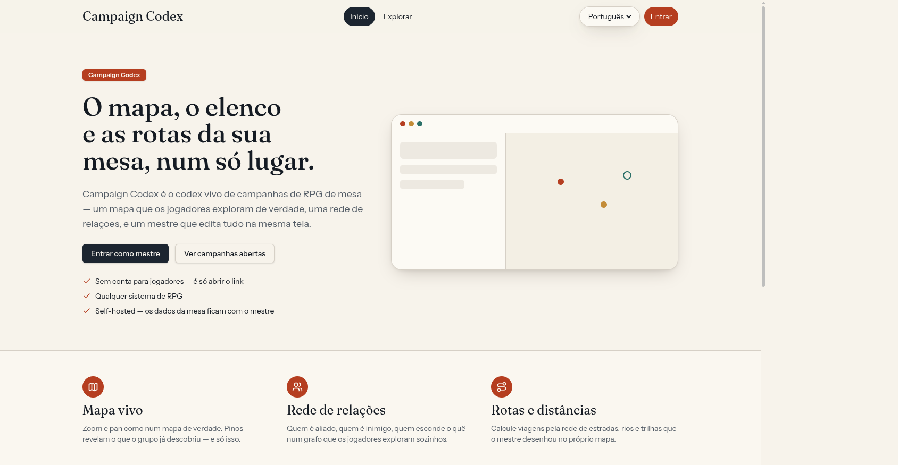

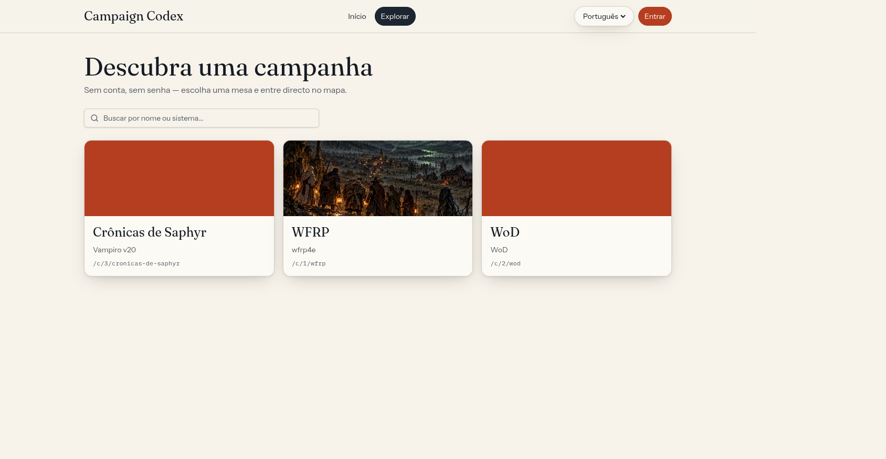

### Mapa, rota e relações

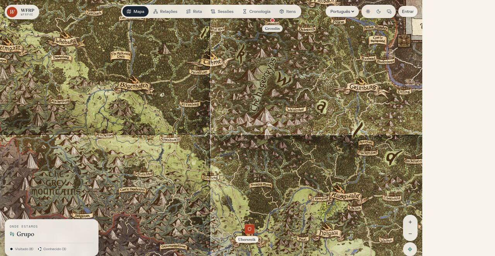

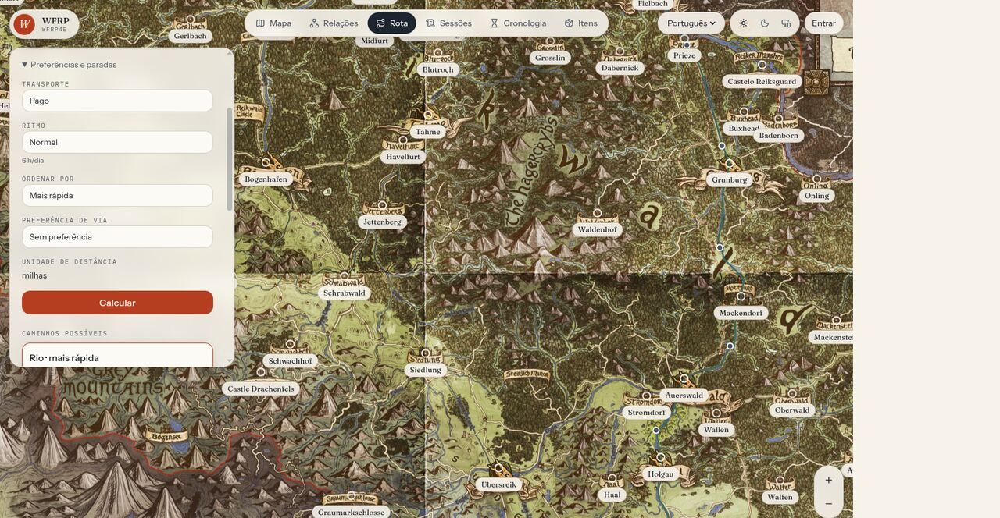

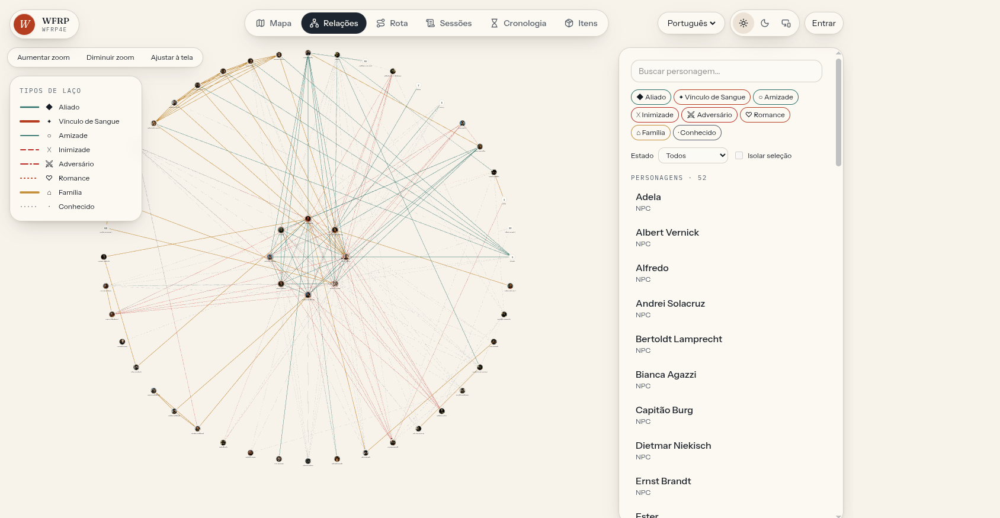

### Sessões, cronologia e itens

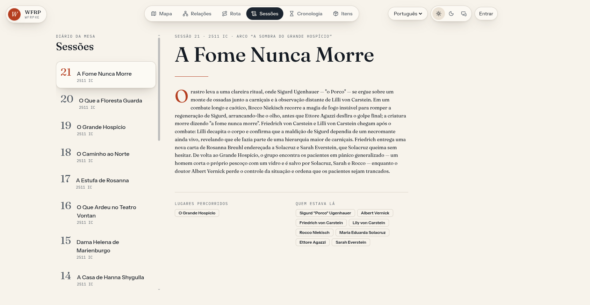

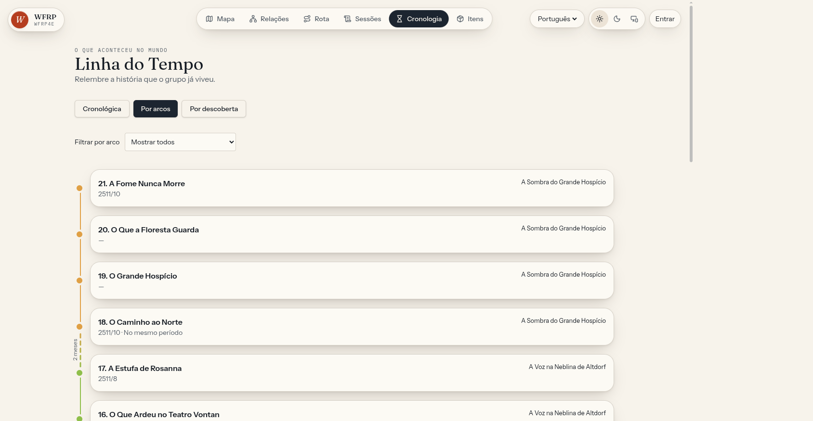

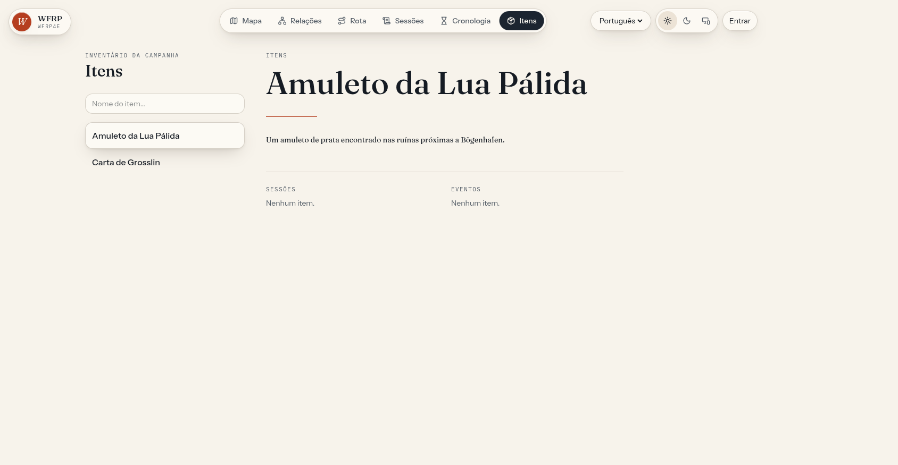

---

## Funcionalidades

### Mapa interativo

- Zoom e pan (roda suave + pinch); controlos `+` / `−` e **Ir ao grupo**
- Pins de locais com cor livre e convenção visual (visitado / conhecido); marcador do **grupo**
- Tamanho estável dos pins ao zoom; clique no pin ou no menu foca a vista
- Modal de leitura ao lado do pin (texto ou Markdown seguro)
- Com local aberto: linhas de **saídas** no mapa
- Sem imagem de mapa na campanha: a app abre directamente em **Relações**

### Rotas e viagem

- Rede de vias (estrada / rio / trilha) digitalizada pelo GM
- **Calcular rota**: De/Para entre nós nomeados; transporte pago/próprio; ritmo; ordenação por tempo ou custo; preferência de via
- Alternativas no mapa (mais rápida destacada)
- **Pernoite** no mapa: pin «ao relento», destaque quando a noite é num Local, e coloração do traçado por fadiga no ritmo intenso
- Pernoite perto de uma cidade (raio em unidades do mapa) deixa de ser «ao relento» e recupera fadiga como noite local
- Vincular nó da rede ↔ Local (o pin segue o nó)

### Rede de Relações (`/relacoes`)

- Grafo PJ/NPC com zoom e pan reais (roda, arrastar fundo, pinça, **Ajustar à tela**)
- Layout radial: sem selecção, PJs no anel interno e NPCs no externo; ao seleccionar, o personagem vai ao centro com vizinhos no anel interno
- Retratos circulares nos nós (fallback para iniciais)
- **8 tipos** de vínculo com cor/estilo: Aliado, Vínculo de Sangue, Amizade, Inimizade, Adversário, Romance, Família, Conhecido
- Modo recíproco ou **duas vias**; qualificador e direcção opcionais
- Filtros por tipo, busca, isolar selecção, legenda PJ/NPC
- Pan na área vazia **não** desseleciona; só um clique simples limpa a selecção
- GM: criar/editar personagens e conexões; ocultar sentidos aos jogadores

### Sessões

- Lista de sessões com resumo em Markdown, associações e visibilidade
- Em desktop, lista e descrição rolam de forma independente
- Clique no nome da campanha na barra leva a **Explorar**

### Linha do Tempo (`/linha-do-tempo`)

- Três modos: **Cronológica**, **Por arcos** e **Por descoberta** (escolha só enquanto está na tela)
- **Por arcos**: coluna vertical por sequência; cor do arco; filtro por arco
- Ligação tracejada com tempo decorrido entre arcos sequenciais; curva automática quando há overlap de datas
- No mesmo mês, desempate pelo número da sessão (mais recente acima); sessões sem data ficam no bloco do próprio arco
- **Por descoberta**: personagens, locais, facções e itens pela primeira aparição (respeita ocultos para jogadores)
- Sugestão opcional por IA para arcos e associações — nada é gravado sem revisão do mestre

### Itens (`/itens`)

- Inventário público da campanha: listagem com busca, detalhe com Markdown e chips de sessões/eventos
- Deep-link `?item=ID`
- Mestre vê também os ocultos (indicação visual) e atalho para criar/editar na Linha do Tempo

### Locais, NPCs e História

- Menu lateral no mapa com Locais, NPCs, História, Rota e Grupo
- Locais agrupados por arco; NPCs com status, facção, retrato e papel
- Associação de PJs/NPCs a locais, com regras de visibilidade

### Modo GM / Painel

- Sessão de mestre em `/login` → `/painel` (criar e gerir campanhas)
- CRUD de locais, personagens, arcos, sessões, eventos e itens; upload de imagens; mover grupo
- Substituir a imagem do mapa; **Rede de rotas** para digitalizar waypoints/segmentos
- API de escrita protegida (membro/dono da campanha); gate «Entrar» na barra

### Contas, contato e termos

- **Criar conta** em `/registo`: a pessoa informa só o e-mail e recebe um link de verificação (válido 5 horas) para definir a senha; contas não confirmadas são apagadas automaticamente. O registo vem **fechado** por padrão (`REGISTO_MODO`), com limites por IP e por e-mail, bloqueio de e-mails descartáveis, campo isca e Turnstile opcional
- **Convite do admin** continua disponível (válido 72 horas) e pode ser enviado também por e-mail
- **Contato** em `/contato`, para qualquer pessoa (com ou sem conta): a mensagem é entregue por e-mail ao administrador da instância e **não é guardada** na aplicação
- **Termos** (`/termos`) e **privacidade** (`/privacidade`), em PT-BR e EN
- **Cota de 300 MB** por campanha (configurável por `COTA_PADRAO_BYTES`)
- **Rodapé** com a versão e os links acima, nas páginas fora de uma campanha
- E-mails enviados pelo Resend; passo a passo em [`docs/runbook-registo-autonomo.md`](docs/runbook-registo-autonomo.md)

### Multi-sistema e multi-campanha

- Uma instância: várias mesas; catálogo em `/explorar` e home em `/`
- Endereço canónico `/c/{id}/{slug}/…` (ex. `/c/1/wfrp/mapa`); links antigos `/c/{slug}/…` redireccionam
- Sistema e módulos por campanha (`control.db`); `GET /api/c/{id|slug}/config`
- Extensões mecânicas por personagem (ex. **fadiga** 0–6 quando o módulo está activo)
- Campanha nova: UI `/painel/novo` ou `uv run python -m app.cli campanha criar`
- Import de instância legada: `campanha importar-legado` — ver runbook de corte

### Interface

- Design system **paper-parchment** (`frontend-v2`): tema **Claro / Escuro / Automático**
- Idiomas **PT-BR** e **EN** (conteúdo escrito pelo mestre não é traduzido)
- Erros da API com códigos estruturados e mensagens localizadas

---

## Novidades da linha 1.4

- Criação de conta pela própria pessoa, com verificação por e-mail, expiração em 5 horas e limpeza automática das contas não confirmadas
- Página de contato pública, entregue por e-mail ao administrador (sem guardar a mensagem)
- Termos de uso, política de privacidade e rodapé com a versão
- Cota de armazenamento por campanha reduzida de 10 GiB para 300 MB
- Pacotes legados `frontend/` e `frontend-next/` removidos; só o `frontend-v2` permanece

---

## Novidades da linha 1.0

- SPA **frontend-v2** (paper-parchment) com navegação Mapa · Relações · Rota · Sessões · Cronologia · Itens
- Itens públicos com busca, detalhe e deep-link
- Rede de Relações com zoom/pan reais, layout radial e retratos nos nós
- Pernoite no mapa de Rota (ao relento / local / raio de abrigo)
- URL canónica `/c/{id}/{slug}`
- Conectores tracejados e desempate no modo Por arcos; rótulos de intervalo rodados ao longo do traço
- Sessões com rolagem independente lista/descrição no desktop
- Atalho do nome da campanha para **Explorar**; barras de rolagem no estilo paper-parchment

Detalhe completo: [`CHANGELOG.md`](CHANGELOG.md).

---

## API e contratos

A API expõe OpenAPI em `/openapi.json` quando está em execução. Inventário de rotas, parâmetros e schemas: [`docs/api-contracts.md`](docs/api-contracts.md).

Domínios cobertos:

- saúde, catálogo, configuração, autenticação e sessão;
- campanhas, proprietários, convites, módulos, capa, visibilidade e unidade de distância;
- registo de contas, contato público e administração de convites com envio por e-mail;
- locais, NPCs, personagens, arcos, sessões, eventos e itens;
- relações entre personagens;
- waypoints, segmentos e planeamento de rotas (incl. pernoite);
- descoberta, associações sugeridas por IA, export/import e uploads;
- administração de utilizadores e recuperação de acesso.

---

## Fluxos principais

### Entrada pública

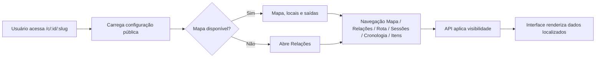

### URL canónica da campanha

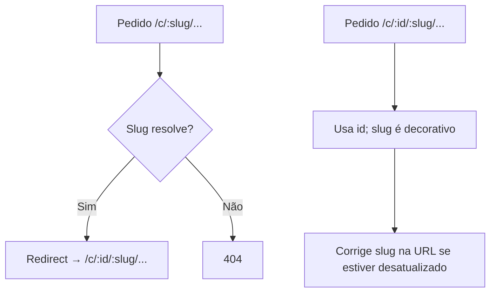

### Calcular rota com pernoite

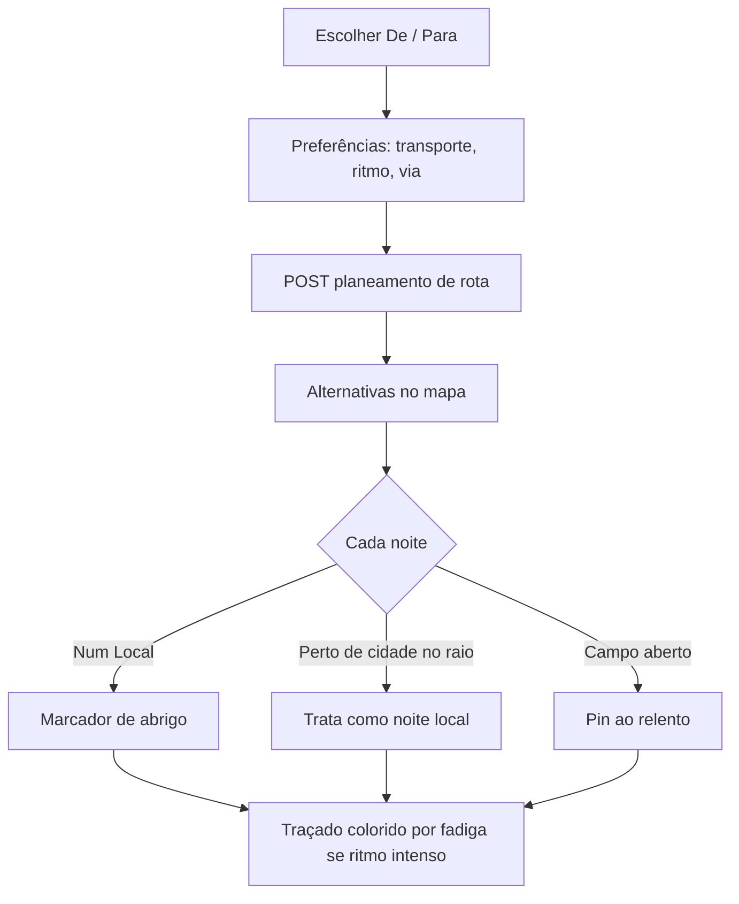

### Itens públicos

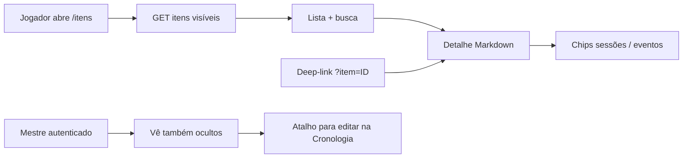

### CRUD do mestre

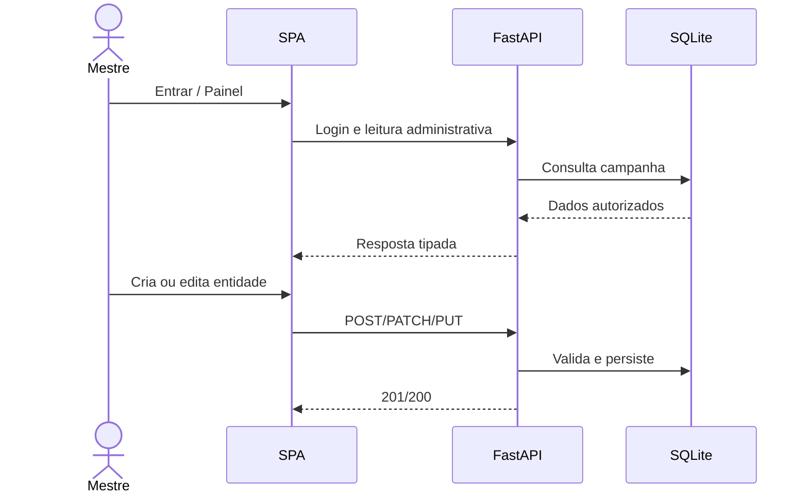

### Sugestões por IA

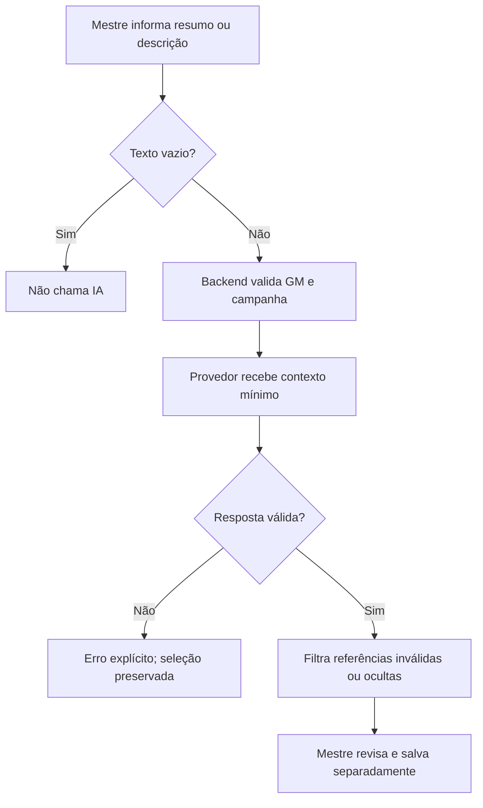

Mais diagramas: [`docs/flows.md`](docs/flows.md).

---

## Stack

| Camada | Tecnologia |
|---|---|
| Frontend | React + Vite + TypeScript + paper-parchment (`frontend-v2`) + `react-i18next` |
| Backend | FastAPI + SQLModel + SQLite |
| E-mail | Resend (transacional) + Turnstile da Cloudflare (opcional) |
| Infra | Docker Compose + Caddy (opcional) |

---

## Desenvolvimento

### Testes

Na raiz, `./scripts/test-fast.sh --frontend` e `--backend` (ou ambos). Playwright e seed: ver [`frontend-v2/README.md`](frontend-v2/README.md).

### Backend

```bash
cd backend
uv sync
# Crie a primeira conta (imprime o link de ativação) e promova-a a admin:
#   uv run python -m app.cli usuario criar --email voce@exemplo.com
#   uv run python -m app.cli usuario promover-admin --email voce@exemplo.com
uv run uvicorn app.main:app --reload --reload-dir app --port 8000

# Seed opcional (só dev/teste)
uv run python -m app.seed
```

Detalhes: [`backend/README.md`](backend/README.md)

### Frontend (v2)

```bash
cd frontend-v2
npm install
npm run dev
```

http://localhost:5173 — proxy `/api` e `/uploads` → `:8000`

Detalhes: [`frontend-v2/README.md`](frontend-v2/README.md)

Rotas úteis:

- `/` — home
- `/explorar` — catálogo público de campanhas
- `/c/{id}/{slug}` — mapa da mesa (ex. `/c/1/wfrp`)
- `/c/{id}/{slug}/relacoes` · `/rota` · `/sessoes` · `/linha-do-tempo` · `/itens`
- `/painel` — minhas campanhas (mestre)
- `/painel/novo` — criar campanha
- `/login` — sessão de mestre
- `/registo` — criar conta (quando o registo está aberto)
- `/convite/{token}` — definir a senha a partir de um convite ou link de verificação
- `/contato` — formulário de contato com o administrador
- `/termos` · `/privacidade` — termos de uso e política de privacidade

> Os pacotes legados `frontend/` e `frontend-next/` foram removidos. O frontend ativo e em produção é `frontend-v2/`.

### Docker

```bash
cp .env.example .env
# Ajuste PUBLIC_BASE_URL, CORS_ORIGINS e TRUSTED_PROXY (veja os comentários do .env.example)
# Registo, e-mail e contato: EMAIL_API_KEY, EMAIL_FROM, REGISTO_MODO, CONTATO_EMAIL
# (ver docs/runbook-registo-autonomo.md). Valores com `$`: no Compose use `$$` ou aspas simples
docker compose up --build
docker compose --profile with-caddy up --build   # porta 8080
```

### Campaign Codex (uma instância)

- Criar mesa: `/painel/novo` ou `uv run python -m app.cli campanha criar …`
- Import legado: `uv run python -m app.cli campanha importar-legado …`
- Snippets Caddy/Tunnel: `./scripts/imprimir-snippets-codex.sh --porta-api PORT --porta-web PORT`
- Runbook: [`docs/runbook-corte-campaign-codex.md`](docs/runbook-corte-campaign-codex.md)

---

## Segurança

- Leitura pública; escrita exige sessão de membro/dono da campanha (fail closed)
- Registo e contato públicos com limites por IP e por e-mail, campo isca e Turnstile opcional; o registo não revela contas existentes e vem fechado por padrão
- Com `REGISTO_MODO=aberto` (ou `CONTATO_EMAIL` definido) em produção, a API exige `TRUSTED_PROXY=true` e, para o registo, e-mail e `PUBLIC_BASE_URL` configurados; ver o runbook
- Gate na SPA: «Entrar» → login do mestre
- Caddy pode reforçar rotas GM em produção
- Jogadores vêem actualizações ao **recarregar** (sem sync ao vivo)

---

## Documentação

| Recurso | Conteúdo |
|---|---|
| [`CHANGELOG.md`](CHANGELOG.md) | Histórico de versões |
| [`docs/manuais.md`](docs/manuais.md) | Índice dos manuais de uso |
| [`docs/manual-mapa.md`](docs/manual-mapa.md) | Mapa: pins, menu, fichas, grupo, calcular rotas, CRUD GM |
| [`docs/manual-rede-rotas.md`](docs/manual-rede-rotas.md) | Nós e segmentos da rede de vias (Modo GM) |
| [`docs/manual-relacoes.md`](docs/manual-relacoes.md) | Rede de Relações: grafo, tipos de vínculo, criar e visualizar |
| [`docs/api-contracts.md`](docs/api-contracts.md) | Inventário OpenAPI |
| [`docs/flows.md`](docs/flows.md) | Fluxos funcionais e operacionais em Mermaid |
| [`docs/runbook-registo-autonomo.md`](docs/runbook-registo-autonomo.md) | Registo de contas, e-mail (Resend), contato, cota e ordem de abertura em produção |
| [`docs/runbook-corte-campaign-codex.md`](docs/runbook-corte-campaign-codex.md) | Corte e operação do Campaign Codex em produção |
| [`openspec/`](openspec/) | Specs OpenSpec por mudança |
| [`frontend-v2/README.md`](frontend-v2/README.md) · [`backend/README.md`](backend/README.md) | Detalhe por camada |
