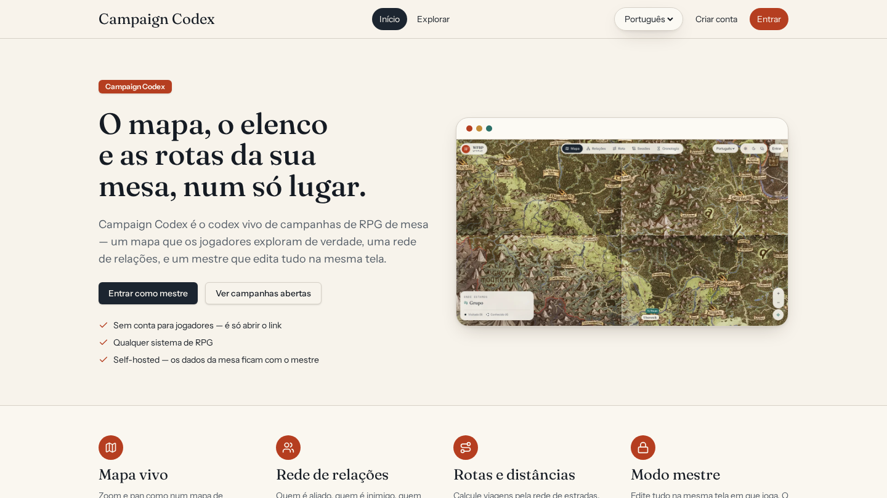
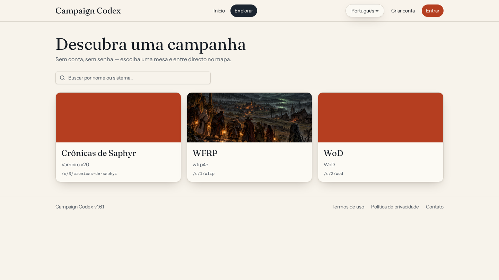
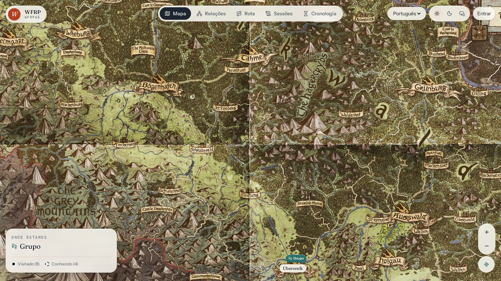
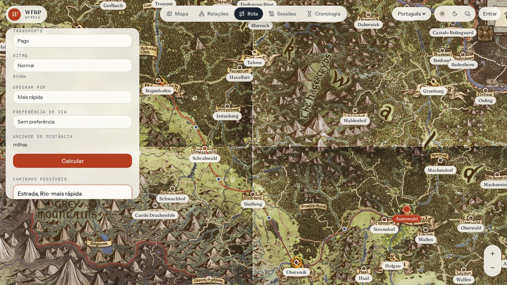
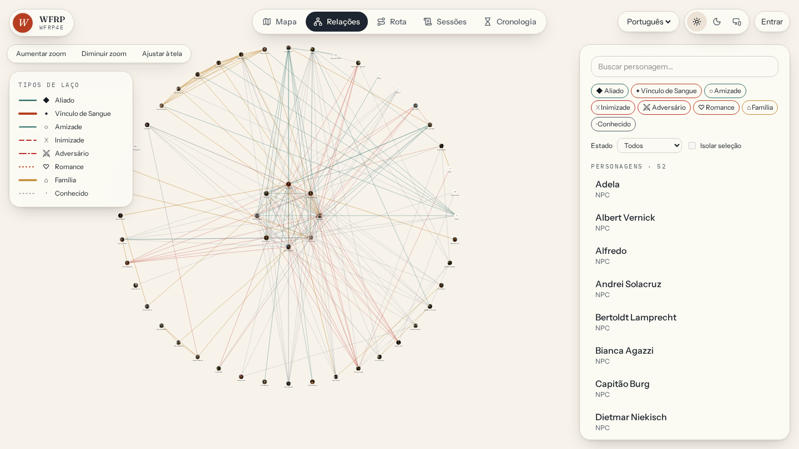
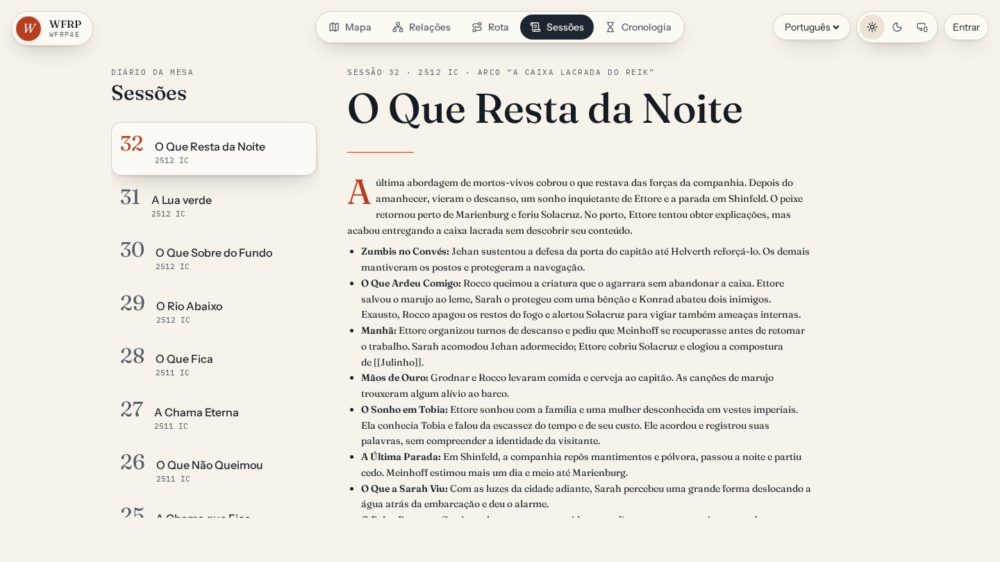
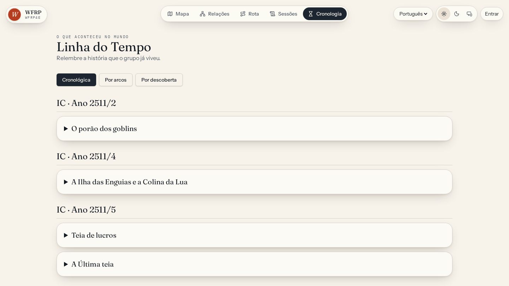
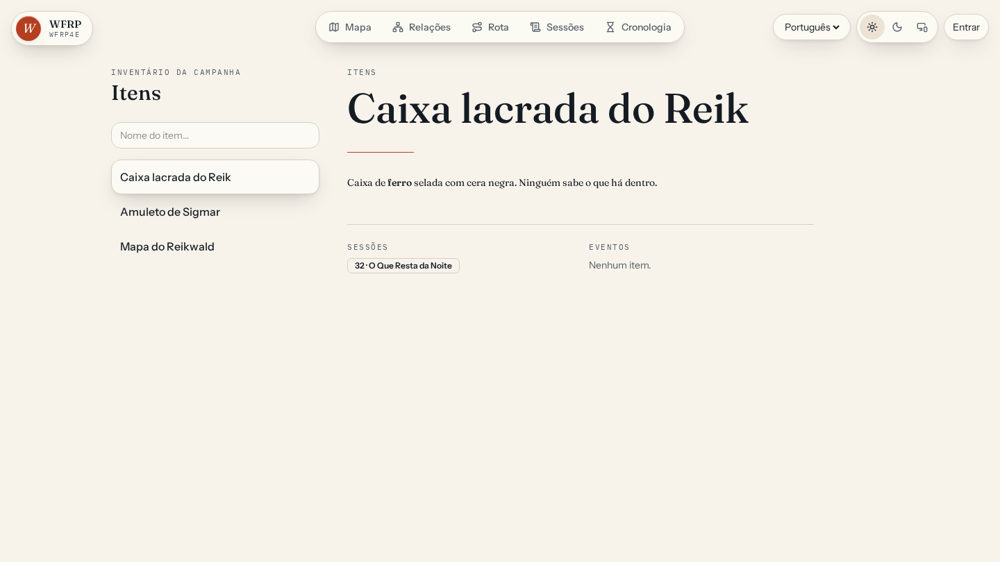
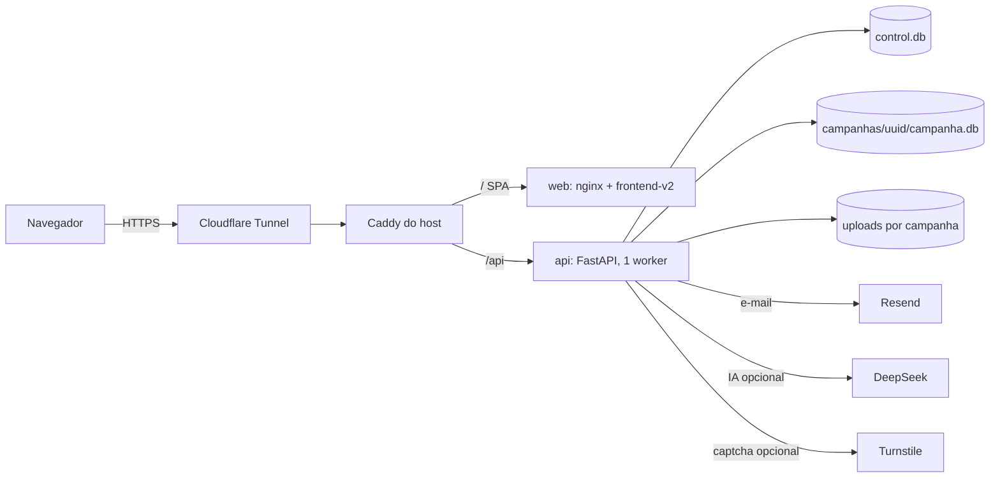

# Codex da Campanha

Aplicação web **self-hosted**, **multi-mestre e multi-campanha**, para os mestres de RPG de mesa organizarem o mundo das suas campanhas e compartilhá-lo com os jogadores: **mapa** interativo, **rotas** com pernoite, **rede de relações**, **sessões**, **linha do tempo**, **itens**, **fios narrativos** e **Modo GM**, com **IA** opcional como assistente de escrita.

**Versão:** 1.7.0 — [`CHANGELOG.md`](CHANGELOG.md)
**Produção:** <https://campaign-codex.1nodado.com.br> — exemplos de campanhas: [`/c/1/wfrp`](https://campaign-codex.1nodado.com.br/c/1/wfrp) e [`/c/2/wod`](https://campaign-codex.1nodado.com.br/c/2/wod) · operação: [`docs/runbook-corte-campaign-codex.md`](docs/runbook-corte-campaign-codex.md)

## Sumário

1. [Objetivo e escopo](#objetivo-e-escopo)
2. [Papéis e permissões](#papéis-e-permissões)
3. [Capturas de ecrã](#capturas-de-ecrã)
4. [Funcionalidades](#funcionalidades)
5. [Arquitetura e funcionamento](#arquitetura-e-funcionamento)
6. [API](#api)
7. [Fluxos de integração](#fluxos-de-integração)
8. [Configuração e operação](#configuração-e-operação)
9. [Stack](#stack) e [Desenvolvimento](#desenvolvimento)
10. [Segurança e privacidade](#segurança-e-privacidade)
11. [Documentação](#documentação)

---

## Objetivo e escopo

### Objetivo

Dar ao mestre um **codex vivo da campanha**: um lugar único onde ele registra locais, personagens, vínculos, sessões, eventos, itens e rotas, e decide, entidade a entidade, **o que os jogadores veem**. Os jogadores acompanham a campanha pela web (mapa, relações, sessões, linha do tempo, itens) sem precisar de conta. A instância é **multi-mestre e multi-campanha**: vários mestres usam a mesma instância, cada um com a sua conta, e **cada mestre pode ter quantas campanhas quiser** (hoje não há limite por conta). As campanhas podem ser de sistemas diferentes (WFRP 4e, World of Darkness e outros) e são isoladas entre si: cada campanha tem o seu banco e as suas imagens, e só o seu dono e membros a administram.

### Escopo — o que a aplicação faz

- **Mapa e viagem:** mapa de imagem com pins de locais, saídas, marcador do grupo, rede de vias (estrada, rio, trilha) e cálculo de rotas com pernoite e fadiga.
- **Mundo da campanha:** locais, personagens (PJ e NPC) com retratos, vínculos entre personagens, arcos, eventos, itens e linha do tempo (cronológica, por arcos e por descoberta).
- **Condução de sessões:** sessões com resumo, notas de preparo privadas, blocos de combate, fios narrativos em aberto e geradores de apoio (nome, rumor, clima, recompensa).
- **Controle de visibilidade:** cada entidade é visível a todos ou só ao mestre; a API aplica a regra em toda resposta pública.
- **Multi-mestre, multi-campanha e multi-sistema:** uma instância com vários mestres, cada mestre com N campanhas; sistema e módulos por campanha (ex.: fadiga, IA), cota de armazenamento por campanha (padrão 300 MB).
- **Contas e acesso:** registo por e-mail com verificação, convite do admin, recuperação de senha, sessão por cookie, console de administração da plataforma.
- **Portabilidade:** exportar e importar uma campanha como pacote ZIP.
- **IA opcional:** assistente de escrita e propostas (arcos, fios, associações) com **revisão obrigatória** do mestre; nada é gravado sem aceite.
- **Contato:** formulário público que entrega a mensagem por e-mail ao administrador da instância.

### Escopo — o que a aplicação **não** faz

- Não é uma mesa virtual (VTT): sem rolagem de dados, fichas completas, iniciativa ou chat.
- Não sincroniza em tempo real: os jogadores veem as atualizações ao recarregar.
- Não tem controle de acesso **por jogador**: a visibilidade é por entidade (todos ou só o mestre).
- Não grava conteúdo gerado pela IA sem revisão e aceite do mestre.
- Não tem tickets de suporte, 2FA, login social, pagamentos nem aplicativo nativo.
- Não guarda as mensagens do formulário de contato (só são enviadas por e-mail).
- Não traduz o conteúdo escrito pelo mestre (só a interface: PT-BR e EN).

---

## Papéis e permissões

| Papel | Como se obtém | O que pode fazer |
|---|---|---|
| **Visitante** | Sem conta | Ler campanhas listadas ou abertas por link (só o que o mestre tornou visível), ver o catálogo em `/explorar`, usar o contato, pedir registo (se aberto) e recuperar a senha |
| **Usuário (mestre)** | Registo por e-mail, ou convite do admin | Entrar em `/painel`, criar **quantas campanhas quiser** (cada uma com o seu sistema, módulos e visibilidade), importar pacotes e gerir as próprias campanhas; não vê nem altera as campanhas de outros mestres |
| **Membro da campanha** | Vínculo (`membro`) com a campanha | Ler a visão do mestre (inclui ocultos) e editar locais, personagens, NPCs, vínculos, sessões, waypoints, rotas, uploads e geradores |
| **Dono da campanha** | Papel `dono`, por campanha (quem cria a campanha, ou quem o admin atribui); o mesmo mestre pode ser dono de N campanhas | Tudo o que o membro faz, mais arcos, eventos, itens, fios, grupo, descoberta, IA, exportação e as configurações da campanha (visibilidade, módulos, capa, unidade) |
| **Admin da plataforma** | Flag `is_admin` na conta | Console `/admin`: usuários (convidar, desativar, resetar senha, remover), campanhas (ativar, trocar dono, remover) |

> Hoje o dono é o único papel de membro criado pela aplicação; as rotas marcadas "Membro" na tabela de rotas também aceitam o dono.

---

## Capturas de ecrã

Capturas da versão **1.7.0** (`frontend-v2`, tema paper-parchment).

### Entrada e exploração





### Mapa, rota e relações







### Sessões, cronologia e itens







---

## Funcionalidades

### Mapa interativo

- Zoom e pan (roda suave + pinch); controlos `+` / `−` e **Ir ao grupo**
- Pins de locais com cor livre e convenção visual (visitado / conhecido); marcador do **grupo**
- Tamanho estável dos pins ao zoom; clique no pin ou no menu foca a vista
- Modal de leitura ao lado do pin (texto ou Markdown seguro)
- Com local aberto: linhas de **saídas** no mapa
- Sem imagem de mapa na campanha: a app abre directamente em **Relações**

### Rotas e viagem

- Rede de vias (estrada / rio / trilha) digitalizada pelo GM
- **Calcular rota**: De/Para entre nós nomeados; transporte pago/próprio; ritmo; ordenação por tempo ou custo; preferência de via
- Alternativas no mapa (mais rápida destacada)
- **Pernoite** no mapa: pin «ao relento», destaque quando a noite é num Local, e coloração do traçado por fadiga no ritmo intenso
- Pernoite perto de uma cidade (raio em unidades do mapa) deixa de ser «ao relento» e recupera fadiga como noite local
- Vincular nó da rede ↔ Local (o pin segue o nó)

### Rede de Relações (`/relacoes`)

- Grafo PJ/NPC com zoom e pan reais (roda, arrastar fundo, pinça, **Ajustar à tela**)
- Slider **Perto — Longe** para aproximar ou afastar os personagens (começa no centro = padrão; duplo clique restaura)
- Layout radial: sem selecção, PJs no anel interno e NPCs no externo; ao seleccionar, o personagem vai ao centro com vizinhos no anel interno
- Retratos circulares nos nós (fallback para iniciais)
- **8 tipos** de vínculo com cor/estilo: Aliado, Vínculo de Sangue, Amizade, Inimizade, Adversário, Romance, Família, Conhecido
- Modo recíproco ou **duas vias**; qualificador e direcção opcionais
- Filtros por tipo, busca, isolar selecção, legenda PJ/NPC
- Pan na área vazia **não** desseleciona; só um clique simples limpa a selecção
- GM: criar/editar personagens e conexões; ocultar sentidos aos jogadores

### Sessões

- Lista de sessões com resumo em Markdown, associações e visibilidade
- Em desktop, lista e descrição rolam de forma independente
- Clique no nome da campanha na barra leva a **Explorar**

### Linha do Tempo (`/linha-do-tempo`)

- Três modos: **Cronológica**, **Por arcos** e **Por descoberta** (escolha só enquanto está na tela)
- **Por arcos**: coluna vertical por sequência; cor do arco; filtro por arco
- Ligação tracejada com tempo decorrido entre arcos sequenciais; curva automática quando há overlap de datas
- No mesmo mês, desempate pelo número da sessão (mais recente acima); sessões sem data ficam no bloco do próprio arco
- **Por descoberta**: personagens, locais, facções e itens pela primeira aparição (respeita ocultos para jogadores)
- Sugestão opcional por IA para arcos e associações — nada é gravado sem revisão do mestre

### Itens (`/itens`)

- Inventário público da campanha: listagem com busca, detalhe com Markdown e chips de sessões/eventos
- Deep-link `?item=ID`
- Mestre vê também os ocultos (indicação visual) e atalho para criar/editar na Linha do Tempo

### Locais, NPCs e História

- Menu lateral no mapa com Locais, NPCs, História, Rota e Grupo
- Locais agrupados por arco; NPCs com status, facção, retrato e papel
- Associação de PJs/NPCs a locais, com regras de visibilidade

### Preparo e leitura de sessão

- **Notas de preparo:** campo Markdown **sempre privado ao mestre**, ao lado do resumo, que não é apagado quando o resumo é preenchido e nunca é servido em contexto de jogador
- **Preparar próxima sessão:** sugere o número, abre o formulário com a sessão oculta aos jogadores (`visivel_para_todos=false`) e foco nas notas
- **Leitura em blocos** (Modo GM): Notas de Preparo, Fios Narrativos e Resumo, recolhíveis, com selo «Só para o mestre» nos blocos privados
- **Blocos de combate** nas notas (`> [!combate] Título`): inimigos, ambiente, tática e desfecho, com cor e ícone próprios
- **Barra de formatação Markdown** nos campos de texto rico, com atalhos Ctrl/Cmd+B e Ctrl/Cmd+I

### Fios narrativos (`/fios`)

- Lista persistente dos fios em aberto da campanha, **só para o mestre dono** (com o Modo GM ligado)
- Cada fio: título, descrição, estado (em aberto/resolvido), origem (manual ou IA), sessão de origem opcional e posição
- Criar, editar, reordenar, resolver, reabrir e remover; o bloco «Fios Narrativos» da sessão permite resolver e reabrir sem sair dela
- A IA pode propor fios; eles só entram depois de aceitos pelo mestre

### Ferramentas do mestre (`/ferramentas`)

- Quatro geradores de apoio: **nome de PNG**, **rumor ou gancho**, **clima e ambiente**, **item ou recompensa**
- O conteúdo respeita o `sistema` da campanha (`wfrp4e`, `wod`) e tem conjunto genérico de reserva para qualquer outro sistema

### Assistente de IA e índice da campanha

- Provedor **DeepSeek**, opcional e por campanha (módulo `ia`); sem `DEEPSEEK_API_KEY` a aplicação sobe e a IA fica indisponível
- Assiste os campos de texto livre (rascunho e resumo de sessão, descrições de personagem e de local) e propõe arcos, fios e associações; **nada é gravado sem aceite**
- Com a IA ligada, o contexto enviado ao provedor pode incluir **conteúdo oculto**; a resposta indica quando isso ocorreu (`usou_conteudo_oculto`)
- **Índice de busca da campanha** (SQLite FTS5, no banco de cada campanha): o contexto é composto por fios em aberto, sessões e arcos recentes, um catálogo de nomes e os trechos mais relevantes ao pedido; o painel mostra o estado e permite reindexar

### Exportar, importar e cota

- **Exportar** uma campanha num pacote ZIP (conteúdo, manifesto e imagens) e **importar** em outra instância ou como cópia; pacotes mais antigos continuam sendo aceitos
- **Cota de 300 MB por campanha** (configurável por `COTA_PADRAO_BYTES`): aviso a 90% e recusa de novos uploads ao exceder; uma campanha acima do limite continua legível e exportável
- Limite por arquivo de upload de 25 MiB e tipos de imagem permitidos (JPEG, PNG, WebP, GIF)

### Modo GM / Painel

- Sessão de mestre em `/login` → `/painel` (criar e gerir campanhas)
- CRUD de locais, personagens, arcos, sessões, eventos e itens; upload de imagens; mover grupo
- Substituir a imagem do mapa; **Rede de rotas** para digitalizar waypoints/segmentos
- Configurações da campanha: visibilidade (**listada** no catálogo ou **só com link**), módulos, capa e unidade de distância (milhas ou quilômetros)
- API de escrita protegida (membro/dono da campanha); gate «Entrar» na barra

### Contas, contato e termos

- **Criar conta** em `/registo`: a pessoa informa só o e-mail e recebe um link de verificação (válido 5 horas) para definir a senha; contas não confirmadas são apagadas automaticamente. O registo vem **fechado** por padrão (`REGISTO_MODO`), com limites por IP e por e-mail, bloqueio de e-mails descartáveis, campo isca e Turnstile opcional
- **Esqueci a senha** em `/esqueci-senha`: link de 1 hora e uso único enviado por e-mail, resposta que não revela contas, só contas ativas recebem o link; redefinir a senha revoga as sessões e nunca reativa uma conta desativada
- **Convite do admin** (válido 72 horas), também por e-mail, e **reset gerado pelo admin** (72 horas)
- **Contato** em `/contato`, para qualquer pessoa (com ou sem conta): a mensagem é entregue por e-mail ao administrador da instância e **não é guardada** na aplicação
- **Termos** (`/termos`) e **privacidade** (`/privacidade`), em PT-BR e EN
- **Rodapé** com a versão e os links acima, nas páginas fora de uma campanha
- E-mails enviados pelo Resend; passo a passo em [`docs/runbook-registo-autonomo.md`](docs/runbook-registo-autonomo.md)

### Administração da plataforma (`/admin`)

- Console do **admin** com usuários (convidar, desativar/reativar, resetar senha, remover) e campanhas (ativar/desativar, trocar o dono, remover com exclusão recuperável)
- Convites em `/admin/convites`, com a opção de enviar o link por e-mail quando o provedor está configurado

### Multi-mestre, multi-campanha e multi-sistema

- Uma instância com **vários mestres**; **cada mestre pode ter N campanhas** (`/painel` lista as suas, `/painel/novo` cria outra); sem limite de campanhas por conta por enquanto
- Cada campanha é isolada: banco, imagens, cota, visibilidade e módulos próprios; um mestre só administra as campanhas de que é dono ou membro
- Catálogo público das campanhas listadas em `/explorar` e home em `/`
- Endereço canónico `/c/{id}/{slug}/…` (ex. `/c/1/wfrp/mapa`); links antigos `/c/{slug}/…` redireccionam
- Sistema e módulos por campanha (`control.db`); `GET /api/c/{id|slug}/config`
- Extensões mecânicas por personagem (ex. **fadiga** 0–6 quando o módulo está activo)
- Campanha nova: UI `/painel/novo` ou `uv run python -m app.cli campanha criar`
- Import de instância legada: `campanha importar-legado` — ver runbook de corte

### Interface

- Design system **paper-parchment** (`frontend-v2`): tema **Claro / Escuro / Automático**
- Idiomas **PT-BR** e **EN** (conteúdo escrito pelo mestre não é traduzido)
- Erros da API com códigos estruturados e mensagens localizadas

---

## Novidades da versão 1.6

- Indexação em buscadores **por campanha, escolha do mestre** (desligada por padrão), com sitemap público, metadados por página e `noindex` nas páginas privadas e nas campanhas não autorizadas
- Cabeçalhos de indexação e 404 real nos snippets do Caddy; runbook de SEO com o passo a passo do Google Search Console

---

## Novidades da versão 1.5

- Recuperação de senha pela própria pessoa (`/esqueci-senha`), com link de 1 hora por e-mail, sem revelar contas e sem nunca reativar uma conta desativada
- Documentação reorganizada: objetivo e escopo, papéis, aplicação multi-mestre e multi-campanha, e páginas próprias para a [API](docs/api-contracts.md) e os [fluxos](docs/flows.md)

---

## Novidades da linha 1.4

- Criação de conta pela própria pessoa, com verificação por e-mail, expiração em 5 horas e limpeza automática das contas não confirmadas
- Página de contato pública, entregue por e-mail ao administrador (sem guardar a mensagem)
- Termos de uso, política de privacidade e rodapé com a versão
- Cota de armazenamento por campanha reduzida de 10 GiB para 300 MB
- Pacotes legados `frontend/` e `frontend-next/` removidos; só o `frontend-v2` permanece

---

## Novidades da linha 1.0

- SPA **frontend-v2** (paper-parchment) com navegação Mapa · Relações · Rota · Sessões · Cronologia · Itens
- Itens públicos com busca, detalhe e deep-link
- Rede de Relações com zoom/pan reais, layout radial e retratos nos nós
- Pernoite no mapa de Rota (ao relento / local / raio de abrigo)
- URL canónica `/c/{id}/{slug}`
- Conectores tracejados e desempate no modo Por arcos; rótulos de intervalo rodados ao longo do traço
- Sessões com rolagem independente lista/descrição no desktop
- Atalho do nome da campanha para **Explorar**; barras de rolagem no estilo paper-parchment

Detalhe completo: [`CHANGELOG.md`](CHANGELOG.md).

---

## Arquitetura e funcionamento

### Visão geral



- **Frontend** (`frontend-v2`): SPA React servida pelo `web`; chama a API com o cookie de sessão.
- **Backend** (`backend`): FastAPI + SQLModel. Resolve a campanha pelo **slug ou id na URL** (`/api/c/{slug}/…`) e abre o banco daquela campanha.
- **Produção:** o acesso externo é só pelo túnel da Cloudflare até o Caddy; nenhuma porta do host é publicada. Por isso `TRUSTED_PROXY=true` é obrigatório (o IP real vem de `CF-Connecting-IP`).

### Dados

| Armazenamento | Conteúdo |
|---|---|
| `DATA_DIR/control.db` | Catálogo: `campanha` (slug, sistema, módulos, visibilidade, cota e uso), `usuario` (e-mail, hash da senha, `is_admin`, `email_canonico`, `termos_aceitos_em`), `membro`, `convite`, `sessao`, `login_bloqueio` (bloqueios de login e contadores de limite) |
| `DATA_DIR/campanhas/<uuid>/campanha.db` | Uma base por campanha: `local`, `npc` (personagens PJ e NPC), `vinculo`, `arco`, `sessao`, `evento`, `item`, `fio_narrativo`, `waypoint`, `route_segment`, `map_scale`, `grupo_posicao`, as tabelas de ligação (`local_npc`, `local_conexao`, `sessao_local`, `sessao_npc`, `evento_local`, `evento_npc`, `item_sessao`, `item_evento`), `campaign_state` e o índice de busca `indice_ia` (FTS5) |
| `DATA_DIR/campanhas/<uuid>/uploads` | Imagens: mapa, retratos e imagens de locais (servidas por `GET /api/c/{slug}/media/…` com ACL) |

- **Migrações:** Alembic em duas árvores, `alembic_control` (banco de controle, hoje na revisão `009_registo_cota`) e `alembic_campaign` (cada campanha, aplicada ao abrir). Rodam no arranque.
- **Isolamento:** uma campanha nunca lê o banco de outra; a exclusão de uma campanha é recuperável.

### Comportamento da API

- **Sessão:** cookie `codex_session` (`HttpOnly`, `SameSite=Lax`, `Secure` fora do modo de depuração). Expira por **12 h de inatividade** ou **30 dias** de vida máxima; é revogada ao desativar a conta ou redefinir a senha.
- **Senhas:** mínimo de 8 caracteres, guardadas com hash Argon2. **5 tentativas falhadas** bloqueiam o e-mail (e o IP) por **15 minutos**.
- **CSRF:** requisições que alteram dados exigem `Origin` (ou `Referer`) dentro de `CORS_ORIGINS`.
- **Limites de taxa** (`slowapi`, por IP, em memória): 5/h no registo, na recuperação de senha e no contato; 30/min nas escritas do mestre; 10/min no assistente de IA e nas propostas da IA (arcos, fios, associações de sessão e de evento); 20/min em uploads; 3/min ao reindexar. Respostas `429` seguem o contrato de erro.
- **Visibilidade:** as rotas públicas filtram por `visivel_para_todos` e a ACL de mídia só serve ao público o que uma entidade visível referencia.
- **Tarefas em segundo plano:** apagar contas não confirmadas (a cada 15 minutos), recuperar exclusões de campanha interrompidas (no arranque) e enviar e-mails de registo e recuperação sem atrasar a resposta.
- **Arranque seguro:** com `REGISTO_MODO=aberto` a API exige provedor de e-mail, `PUBLIC_BASE_URL` em HTTPS, a origem em `CORS_ORIGINS` e `TRUSTED_PROXY=true`; com `CONTATO_EMAIL` ou `EMAIL_API_KEY` definido (e `DEBUG=false`) exige `TRUSTED_PROXY=true`.

---

## SEO e indexação

O dono pode permitir a indexação de cada campanha listada no Painel; a opção começa desligada. O sitemap público está em `GET /sitemap.xml`. Para aplicar os cabeçalhos e conferir a descoberta no buscador, veja o [runbook de SEO](docs/runbook-seo.md).

## API

A API é **JSON sobre HTTP** e fica sob `/api`. A especificação em execução é o OpenAPI (`/api/openapi.json`, interface em `/api/docs`).

**As rotas, os contratos principais, os esquemas de cada contrato e o catálogo de códigos de erro estão em [`docs/api-contracts.md`](docs/api-contracts.md).**

### Em resumo

- **Campanha:** `{slug}` aceita o slug (`wfrp`) ou o id numérico (`1`); o endereço canônico do frontend é `/c/{id}/{slug}/…`.
- **Autenticação:** cookie de sessão `codex_session`, criado por `POST /api/auth/login` ou ao aceitar um convite. Sem sessão válida, as rotas protegidas respondem `401 AUTENTICACAO_NECESSARIA`; falta de papel responde `403` (`NAO_MEMBRO`, `NAO_DONO`, `NAO_ADMINISTRADOR`).
- **Erros estruturados:** `{"detail": {"erro": "CODIGO", "detalhes": {…}}}`; o frontend traduz o código. Erros de validação do corpo (`422`) seguem o formato padrão do FastAPI.
- **Limites de taxa:** `429` com `LIMITE_PEDIDOS`, `LIMITE_REGISTO` ou `LIMITE_CONTATO_DIARIO`.
- **Respostas genéricas:** `POST /api/auth/registo` e `POST /api/auth/reset/pedir` devolvem sempre `202 {"ok": true}`, para não revelar se um e-mail tem conta.
- **Indexação:** `PATCH /api/campanhas/{slug}/indexacao` altera a escolha do dono; `GET /sitemap.xml` publica as páginas autorizadas.
- **Uploads e mídia:** `POST …/admin/uploads` (multipart) valida tipo, tamanho e cota; a mídia é servida por `GET /api/c/{slug}/media/{categoria}/{arquivo}`. Os caminhos antigos `/uploads/…` respondem `410 Gone`.

### Áreas da API

| Área | Prefixo | Acesso | Rotas |
|---|---|---|---|
| Autenticação, registo e recuperação de senha | `/api/auth` | Público (`/me` exige sessão) | 9 |
| Contato público | `/api/contato` | Público | 2 |
| Campanhas do usuário e catálogo | `/api/campanhas` | Catálogo público; demais exigem sessão ou dono | 8 |
| Administração da plataforma | `/api/admin` | Admin da plataforma | 10 |
| Campanha — leitura | `/api/c/{slug}` | Público, respeitando a visibilidade | 21 |
| Campanha — escrita do mestre | `/api/c/{slug}/admin` | Membro ou dono da campanha | 66 |
| Saúde e caminhos legados | `/api/health`, `/uploads/…` | Público | 3 |

Total: **119 operações**.

---

## Fluxos de integração

Os diagramas Mermaid dos fluxos estão em [`docs/flows.md`](docs/flows.md):

- **Acesso público:** [entrada na campanha](docs/flows.md#entrada-pública), [URL canônica](docs/flows.md#url-canónica-da-campanha), [itens públicos](docs/flows.md#itens-públicos)
- **Mapa e viagem:** [cálculo de rota com pernoite](docs/flows.md#calcular-rota-com-pernoite), [linha do tempo por arcos e descoberta](docs/flows.md#linha-do-tempo-por-arcos-e-descoberta)
- **Conta e acesso:** [sessão e login](docs/flows.md#sessão-e-login), [criação de conta com verificação por e-mail](docs/flows.md#criação-de-conta-com-verificação-por-e-mail), [recuperação de senha](docs/flows.md#recuperação-de-senha), [convite do admin](docs/flows.md#convite-do-admin), [contato com o administrador](docs/flows.md#contato-com-o-administrador)
- **Mestre:** [CRUD do mestre](docs/flows.md#crud-do-mestre), [sugestões por IA](docs/flows.md#sugestões-por-ia)
- **Campanha:** [criar campanha, enviar imagens e respeitar a cota](docs/flows.md#criar-campanha-enviar-imagens-e-respeitar-a-cota), [exportar e importar](docs/flows.md#exportar-e-importar-uma-campanha)
- **Operação:** [deploy e operação](docs/flows.md#deploy-e-operação)

---

## Configuração e operação

### Variáveis de ambiente

Copie `.env.example` para `.env` (nunca commite o `.env`). Resumo:

| Variável | Para quê | Padrão |
|---|---|---|
| `DEBUG` | Modo de depuração (cookie sem `Secure`, e-mails em arquivo, validações de arranque relaxadas) | `false` |
| `CORS_ORIGINS` | Origens permitidas (também usadas pelo CSRF) | — |
| `PUBLIC_BASE_URL` | Base dos links enviados por e-mail (em produção: HTTPS) | `http://localhost:5173` |
| `COOKIE_SECURE` | Força `Secure` no cookie de sessão | `Secure` quando `DEBUG=false` |
| `TRUSTED_PROXY` | Usa `CF-Connecting-IP`/`X-Forwarded-For` para o IP do cliente (**`true` em produção**) | `false` |
| `DATA_DIR` | Pasta de dados (`control.db`, campanhas e uploads) | `./data` |
| `MAX_UPLOAD_BYTES` | Limite por arquivo de upload | 25 MiB |
| `COTA_PADRAO_BYTES` | Cota de armazenamento por campanha | 300 MiB |
| `REGISTO_MODO` | `fechado` ou `aberto` (registo público) | `fechado` |
| `EMAIL_API_KEY`, `EMAIL_FROM` | Provedor de e-mail (Resend) | — |
| `EMAIL_LOG_FILE` | Em depuração, grava os e-mails num arquivo em vez de enviá-los | — |
| `TURNSTILE_SECRET`, `TURNSTILE_SITE_KEY` | Captcha do Cloudflare (opcional) | — |
| `REGISTO_DOMINIOS_BLOQUEADOS` | Arquivo extra de domínios de e-mail descartável | — |
| `CONTATO_EMAIL` | Endereço do administrador que recebe os contatos | — |
| `CONTATO_LIMITE_DIARIO`, `CONTATO_LIMITE_PRIVACIDADE` | Tetos diários de mensagens (geral e da categoria de privacidade) | 30 e 10 |
| `DEEPSEEK_API_KEY`, `DEEPSEEK_BASE_URL`, `DEEPSEEK_MODEL`, `DEEPSEEK_TIMEOUT_SECONDS` | IA (opcional) | — |
| `COMPOSE_PROJECT_NAME`, `PORTA_API`, `PORTA_WEB` | Multi-deploy com Docker Compose | — |
| `VITE_API_BASE` | Base da API no frontend (vazio = mesmo domínio) | vazio |
| `CAMPAIGN_SLUG`, `SISTEMA`, `MODULOS_ATIVOS` | Só para `python -m app.seed` e ferramentas locais | — |

> **Ordem em produção:** defina `TRUSTED_PROXY=true` **antes** de `EMAIL_API_KEY` ou `CONTATO_EMAIL`; com `DEBUG=false` a API não arranca com a chave e o proxy não confiável.

### Linha de comando (`uv run python -m app.cli …`)

| Comando | O que faz |
|---|---|
| `campanha criar` / `listar` | Cria uma campanha isolada / lista as do catálogo |
| `campanha atribuir-dono` | Atribui o dono (substitui o anterior) |
| `campanha reconciliar-cota` | Recalcula `bytes_usados` a partir do disco |
| `campanha exportar` / `importar` | Exporta/importa um pacote ZIP |
| `campanha importar-legado` | Importa uma instância legada (ver o runbook de corte) |
| `usuario criar` | Cria um usuário pendente e imprime o link de ativação |
| `usuario reset` | Emite um link de reset de senha |
| `usuario desactivar` | Desativa o usuário e revoga as sessões |
| `usuario promover-admin` / `rebaixar-admin` | Promove/rebaixa um administrador da plataforma |
| `usuario limpar-pendentes` | Apaga registos não confirmados e expirados |

### Primeiros passos em produção

1. Subir com o Docker Compose e o `.env` configurado; a migração do banco de controle roda no arranque.
2. Criar a primeira conta e promovê-la: `usuario criar --email …` e `usuario promover-admin --email …`.
3. Testar o envio de e-mail com um convite do admin; só então definir `REGISTO_MODO=aberto`.
4. Antes de divulgar o registo ao público amplo, planejar cotas de IA e um limite de campanhas por conta (fora do escopo atual).

Detalhes: [`docs/runbook-registo-autonomo.md`](docs/runbook-registo-autonomo.md) e [`docs/runbook-corte-campaign-codex.md`](docs/runbook-corte-campaign-codex.md).

---

## Stack

| Camada | Tecnologia |
|---|---|
| Frontend | React + Vite + TypeScript + paper-parchment (`frontend-v2`) + `react-i18next` |
| Backend | FastAPI + SQLModel + SQLite |
| E-mail | Resend (transacional) + Turnstile da Cloudflare (opcional) |
| Infra | Docker Compose + Caddy (opcional) |

---

## Desenvolvimento

### Testes

Na raiz, `./scripts/test-fast.sh --frontend` e `--backend` (ou ambos). Playwright e seed: ver [`frontend-v2/README.md`](frontend-v2/README.md).

### Backend

```bash
cd backend
uv sync
# Crie a primeira conta (imprime o link de ativação) e promova-a a admin:
#   uv run python -m app.cli usuario criar --email voce@exemplo.com
#   uv run python -m app.cli usuario promover-admin --email voce@exemplo.com
uv run uvicorn app.main:app --reload --reload-dir app --port 8000

# Seed opcional (só dev/teste)
uv run python -m app.seed
```

Detalhes: [`backend/README.md`](backend/README.md)

### Frontend (v2)

```bash
cd frontend-v2
npm install
npm run dev
```

http://localhost:5173 — proxy `/api` e `/uploads` → `:8000`

Detalhes: [`frontend-v2/README.md`](frontend-v2/README.md)

Rotas úteis:

- `/` — home
- `/explorar` — catálogo público de campanhas
- `/c/{id}/{slug}` — mapa da mesa (ex. `/c/1/wfrp`)
- `/c/{id}/{slug}/relacoes` · `/rota` · `/sessoes` · `/linha-do-tempo` · `/itens` · `/ferramentas` · `/fios`
- `/painel` — minhas campanhas (mestre)
- `/painel/novo` — criar campanha
- `/login` — sessão de mestre
- `/registo` — criar conta (quando o registo está aberto)
- `/esqueci-senha` — pedir um link para recuperar a senha
- `/reset/{token}` — definir a nova senha a partir do link de recuperação
- `/conta` — conta do usuário
- `/admin` · `/admin/convites` — console da plataforma (admin)
- `/convite/{token}` — definir a senha a partir de um convite ou link de verificação
- `/contato` — formulário de contato com o administrador
- `/termos` · `/privacidade` — termos de uso e política de privacidade

> Os pacotes legados `frontend/` e `frontend-next/` foram removidos. O frontend ativo e em produção é `frontend-v2/`.

### Docker

```bash
cp .env.example .env
# Ajuste PUBLIC_BASE_URL, CORS_ORIGINS e TRUSTED_PROXY (veja os comentários do .env.example)
# Registo, e-mail e contato: EMAIL_API_KEY, EMAIL_FROM, REGISTO_MODO, CONTATO_EMAIL
# (ver docs/runbook-registo-autonomo.md). Valores com `$`: no Compose use `$$` ou aspas simples
docker compose up --build
docker compose --profile with-caddy up --build   # porta 8080
```

### Campaign Codex (uma instância)

- Criar mesa: `/painel/novo` ou `uv run python -m app.cli campanha criar …`
- Import legado: `uv run python -m app.cli campanha importar-legado …`
- Snippets Caddy/Tunnel: `./scripts/imprimir-snippets-codex.sh --porta-api PORT --porta-web PORT`
- Runbook: [`docs/runbook-corte-campaign-codex.md`](docs/runbook-corte-campaign-codex.md)

---

## Segurança e privacidade

- Leitura pública; escrita exige sessão de membro/dono da campanha (fail closed)
- Cookie de sessão `HttpOnly`/`SameSite=Lax`, CSRF por origem, senhas com Argon2 e bloqueio por tentativas
- Registo, recuperação de senha e contato públicos com limites por IP e por e-mail, campo isca e Turnstile opcional; as respostas não revelam contas existentes
- Redefinir a senha revoga as sessões, e um link de reset nunca reativa uma conta desativada
- Com `REGISTO_MODO=aberto` ou `CONTATO_EMAIL`/`EMAIL_API_KEY` em produção, a API valida a configuração no arranque (ver *Configuração e operação*)
- Privacidade: a aplicação guarda e-mail, hash da senha e o momento do aceite dos termos; usa IP e hash de e-mail em contadores temporários; não guarda as mensagens de contato; não usa analytics nem cookies de terceiros. Serviços externos: Resend (e-mail), DeepSeek (só quando a IA é usada) e Turnstile (quando ativo). Detalhes em `/privacidade`
- Caddy pode reforçar rotas GM em produção
- Jogadores veem atualizações ao **recarregar** (sem sync ao vivo)

---

## Documentação

| Recurso | Conteúdo |
|---|---|
| [`CHANGELOG.md`](CHANGELOG.md) | Histórico de versões |
| [`docs/manuais.md`](docs/manuais.md) | Índice dos manuais de uso |
| [`docs/manual-mapa.md`](docs/manual-mapa.md) | Mapa: pins, menu, fichas, grupo, calcular rotas, CRUD GM |
| [`docs/manual-rede-rotas.md`](docs/manual-rede-rotas.md) | Nós e segmentos da rede de vias (Modo GM) |
| [`docs/manual-relacoes.md`](docs/manual-relacoes.md) | Rede de Relações: grafo, tipos de vínculo, criar e visualizar |
| [`docs/api-contracts.md`](docs/api-contracts.md) | API: rotas, contratos principais, esquemas e códigos de erro |
| [`docs/flows.md`](docs/flows.md) | Fluxos de integração em Mermaid (acesso, conta, mestre, campanha e operação) |
| [`docs/runbook-seo.md`](docs/runbook-seo.md) | Caddy, sitemap, Search Console e verificação da indexação |
| [`docs/runbook-registo-autonomo.md`](docs/runbook-registo-autonomo.md) | Registo de contas, e-mail (Resend), contato, recuperação de senha, cota e ordem de abertura em produção |
| [`docs/runbook-corte-campaign-codex.md`](docs/runbook-corte-campaign-codex.md) | Corte e operação do Campaign Codex em produção |
| [`openspec/`](openspec/) | Specs OpenSpec por mudança |
| [`frontend-v2/README.md`](frontend-v2/README.md) · [`backend/README.md`](backend/README.md) | Detalhe por camada |
