# Fluxos do Campaign Codex

Diagramas de referência dos fluxos de integração da versão 1.6.1. Eles descrevem o comportamento da aplicação e complementam as rotas e os contratos em [`api-contracts.md`](api-contracts.md). Visão geral: [`README.md`](../README.md).

## Sumário

1. [Entrada pública](#entrada-pública)
2. [URL canónica da campanha](#url-canónica-da-campanha)
3. [Calcular rota com pernoite](#calcular-rota-com-pernoite)
4. [Itens públicos](#itens-públicos)
5. [CRUD do mestre](#crud-do-mestre)
6. [Sugestões por IA](#sugestões-por-ia)
7. [Sessão e login](#sessão-e-login)
8. [Criação de conta com verificação por e-mail](#criação-de-conta-com-verificação-por-e-mail)
9. [Recuperação de senha](#recuperação-de-senha)
10. [Contato com o administrador](#contato-com-o-administrador)
11. [Convite do admin](#convite-do-admin)
12. [Criar campanha, enviar imagens e respeitar a cota](#criar-campanha-enviar-imagens-e-respeitar-a-cota)
13. [Exportar e importar uma campanha](#exportar-e-importar-uma-campanha)
14. [Linha do Tempo por arcos e descoberta](#linha-do-tempo-por-arcos-e-descoberta)
15. [Deploy e operação](#deploy-e-operação)

## Entrada pública

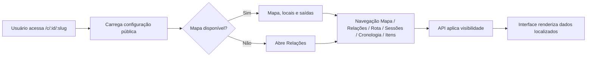

## URL canónica da campanha

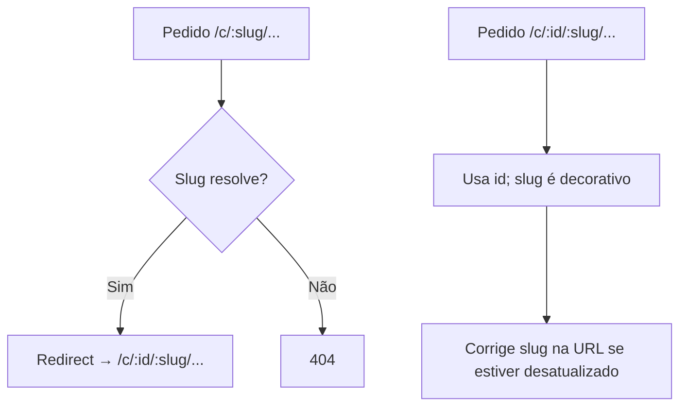

## Calcular rota com pernoite

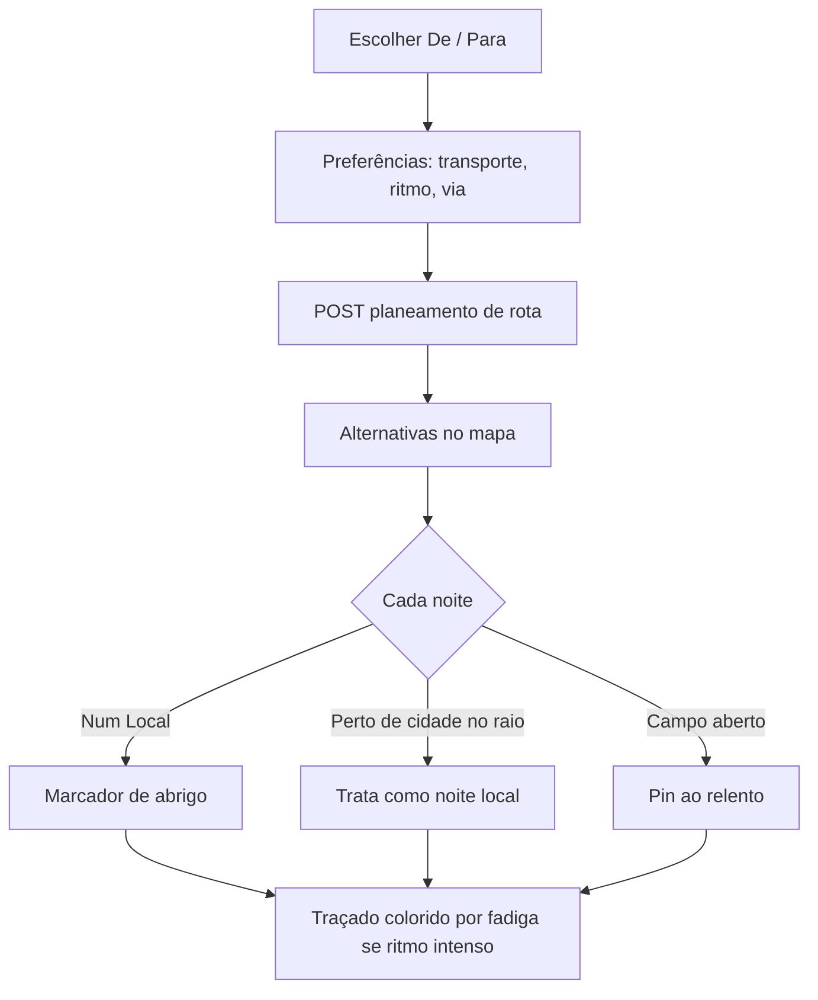

## Itens públicos

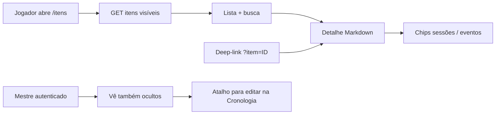

## CRUD do mestre

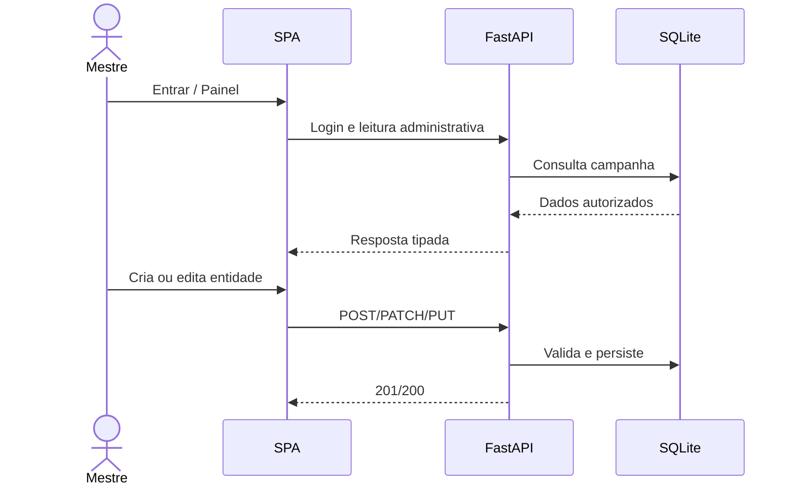

## Sugestões por IA

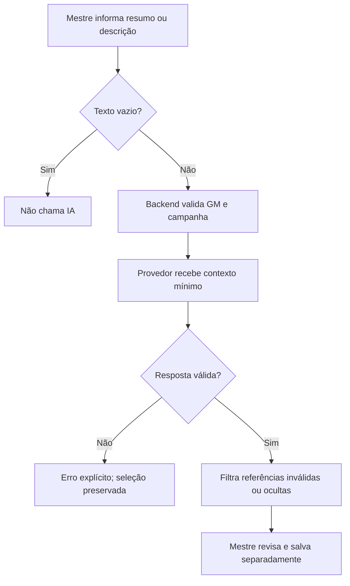

## Sessão e login

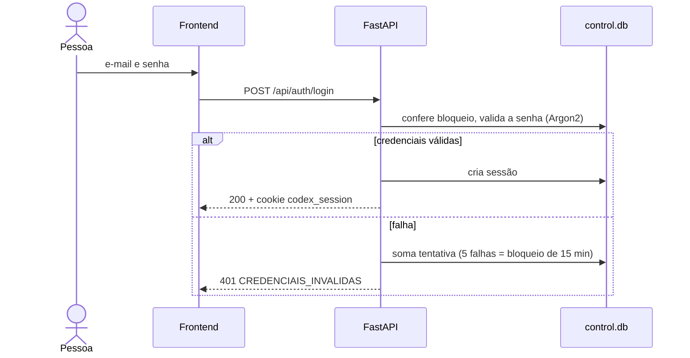

## Criação de conta com verificação por e-mail

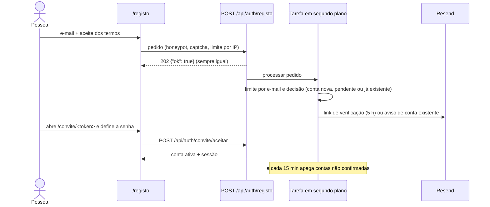

## Recuperação de senha

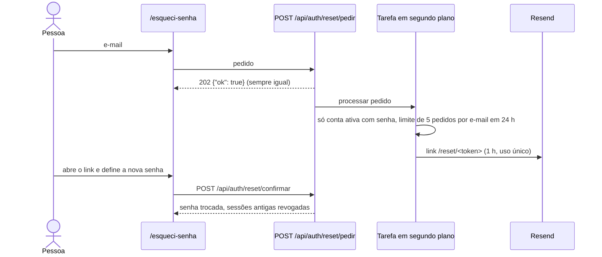

## Contato com o administrador

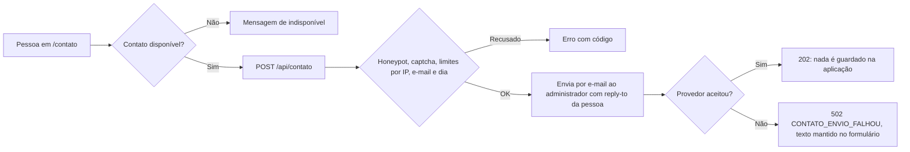

## Convite do admin

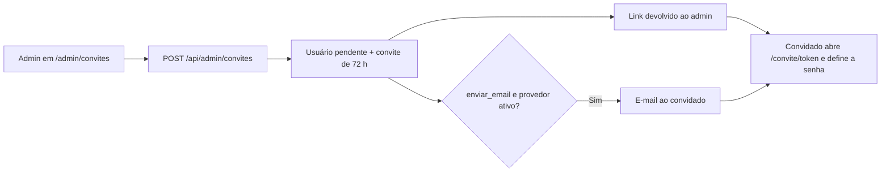

## Criar campanha, enviar imagens e respeitar a cota

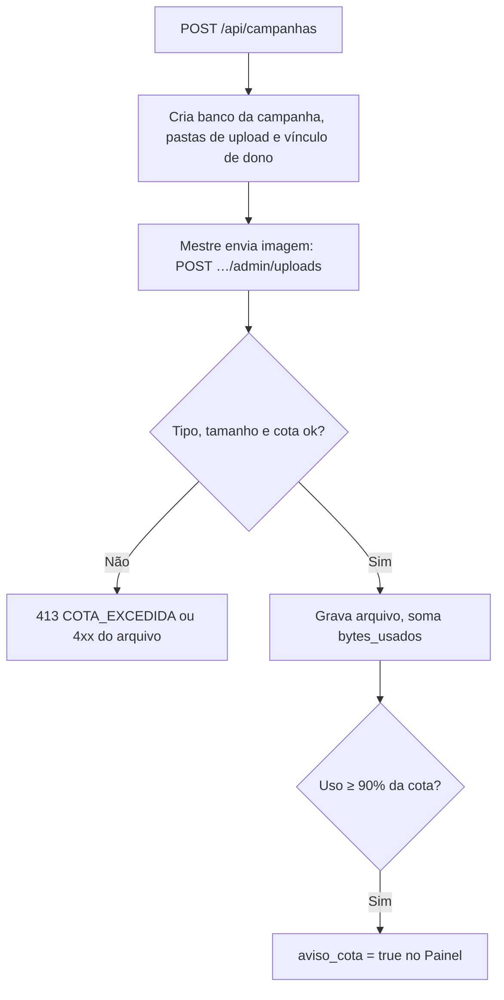

## Exportar e importar uma campanha

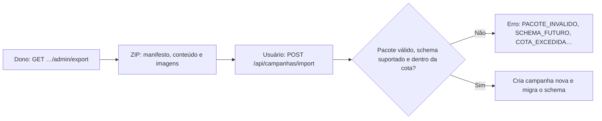

## Linha do Tempo por arcos e descoberta

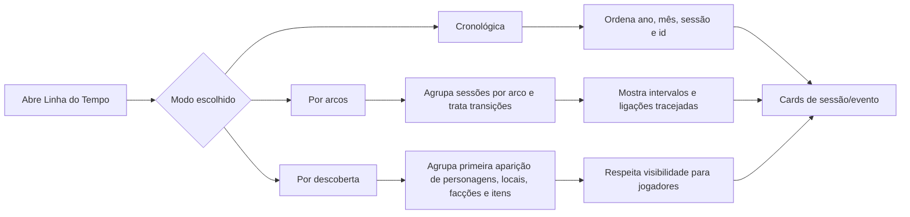

## Deploy e operação

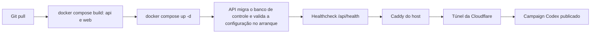

- A migração do banco de cada campanha roda quando a campanha é aberta.
- Com `REGISTO_MODO=aberto`, `CONTATO_EMAIL` ou `EMAIL_API_KEY` definidos e `DEBUG=false`, a API só arranca com `TRUSTED_PROXY=true` (ver o README, seção *Configuração e operação*).
- A cada 15 minutos uma tarefa apaga as contas de registo não confirmadas.
