# Design

## Context

O backend (FastAPI + SQLModel, control DB SQLite com Alembic em `alembic_control`, **um worker uvicorn**) já tem `Usuario` (`activo`, `senha_hash` anulável), `Convite` (token opaco com hash, `tipo`, `expira_em`, `consumido_em`), `slowapi` (`limiter` em memória, chave = IP via `client_ip()`) e lockout de login em `LoginBloqueio`. O fluxo de ativação (`accept_activate_invite`, rota `/api/auth/convite/aceitar`, página `/convite/:token`) já define a senha, ativa a conta e abre sessão. O admin console já classifica contas: **pendente** = inativa sem senha; **inativa** = inativa com senha (desativada pelo admin). Não existe envio de e-mail: o admin copia o link. A produção é alcançada exclusivamente por um túnel da Cloudflare (conexão de saída, sem porta pública) até o Caddy do host, e só `frontend-v2` é servido pelo `web` do compose (`frontend/` e `frontend-next/` são legados e não mudam). O limite de cota está em: `Campanha.cota_bytes` (default 10 GiB), a constante de módulo `DEFAULT_COTA_BYTES` em `campanha_admin.py` (usada por `legacy_import` e `campaign_import`) e a coluna gravada por campanha. Ver proposal.md para a motivação.

## Goals / Non-Goals

**Goals:**
- Reaproveitar o fluxo `Convite` → `/convite/:token` ao máximo; a novidade é o tipo `verificar`, o endpoint público, o envio de e-mail e a limpeza.
- Nenhum caminho do registo permite enumerar e-mails nem reativar contas desativadas.
- Cota única e configurável, aplicada a todas as campanhas.
- Falhar cedo no arranque quando a configuração tornaria o registo inseguro ou inútil.

**Non-Goals:**
- Recuperação de senha por auto-serviço (continua gerada pelo admin).
- Aprovação manual de contas, cotas de IA e limite de campanhas por conta.
- Filas externas (Celery/Redis) ou novo serviço de agendamento.
- Alterar `frontend/` ou `frontend-next/`.

## Fluxo e estados

```mermaid
sequenceDiagram
    participant U as Pessoa
    participant W as frontend-v2 /registo
    participant A as API POST /api/auth/registo
    participant B as Tarefa em background
    participant E as EmailSender (Resend)
    U->>W: e-mail + aceite (+ captcha)
    W->>A: pedido
    A->>A: modo, aceite, honeypot, captcha, formato, domínio descartável, limite por IP
    A-->>W: 202 genérico (antes de consultar a conta)
    A->>B: agenda processamento
    B->>B: limite por e-mail canonicalizado; decide novo / pendente / ativo / desativado
    B->>E: verificação (novo, pendente) ou aviso (ativo, desativado)
    U->>W: abre /convite/:token e define a senha
    W->>A: POST /api/auth/convite/aceitar
    A-->>W: conta ativa + sessão
```

```mermaid
stateDiagram-v2
    [*] --> Pendente: registo ou convite do admin
    Pendente --> Ativa: define a senha (convite activar ou verificar válido)
    Pendente --> [*]: limpeza (só se todos os convites forem verificar e o mais recente expirou)
    Ativa --> Desativada: admin desativa
    Desativada --> Ativa: admin reativa
    note right of Desativada: o registo nunca reativa; só envia aviso
```



## Decisions

1. **Tipo de convite `verificar`, mesmo consumo que `activar`.** `issue_invite` ganha o tipo `verificar` com TTL próprio (`REGISTO_TTL_HORAS=5`, constante no serviço); `_load_valid_invite` passa a aceitar um conjunto de tipos (`activar`, `verificar`) e `accept_activate_invite` aceita ambos. `invite_url` hoje manda qualquer tipo que não seja `activar` para `/reset/…`; deve tratar `verificar` como `/convite/{token}` e um teste cobre isso. *Alternativa:* rota nova de verificação — rejeitada, duplicaria a definição de senha.

2. **Regra de estados do `Usuario`.** *Pendente* = `activo=False` **e** `senha_hash is None` (a mesma regra de `admin_console`). *Desativada* = `activo=False` **com** senha. O pedido de registo cria um `Usuario` pendente apenas para e-mails novos. Para pendente: invalida os `verificar` anteriores fixando `expira_em = agora` (não `consumido_em`, para que o link antigo mostre "expirado" e a limpeza continue possível) e emite outro. Para ativa ou desativada: não emite convite, só envia o aviso de "já tem conta". **Uma conta desativada nunca é reativada pelo registo.** *Alternativa:* só criar o usuário na ativação, guardando o e-mail no token — rejeitada: exigiria tabela nova para o e-mail pendente e não simplifica o rate limit por e-mail.

3. **Limpeza só de contas auto-registadas.** `purge_unverified_signups` apaga usuários que cumpram **todas**: pendente, sem `Membro`, sem `Sessao`, com pelo menos um convite, todos do tipo `verificar`, e o mais recente já expirado (reavaliado dentro da mesma transação). Como pendente implica sem senha, nenhum `verificar` consumido com sucesso pode existir numa conta pendente; os invalidados ficam expirados. Reaproveita o corpo de `delete_user` extraído para uma função sem as verificações de "última admin" e "dono de mesas" (que não se aplicam a pendentes), apagando também `Convite`, `Sessao`, `Membro` e o `LoginBloqueio` de login. **O contador do registo não é apagado**: ele expira sozinho ao fim da janela, senão o atacante, cujas contas nunca são confirmadas, reiniciaria o limite a cada limpeza. Convites do admin (`activar`) ficam de fora por construção.

4. **Resposta genérica com trabalho em background.** `POST /api/auth/registo` valida, de forma síncrona e sem tocar na conta: modo, aceite, honeypot, captcha, formato, domínio descartável, e o limite por IP; e devolve sempre `202 {"ok": true}`. A decisão sobre a conta, a escrita na base e o envio correm em `BackgroundTasks`, com sessão própria (`Session(get_control_engine())` aberta dentro da tarefa). O corpo e o estado são idênticos nos quatro casos; o critério de verificação é "mesmo corpo e status e nenhum acesso à base que dependa da conta antes da resposta", não igualdade de latência. Erros de formato e de domínio descartável podem ser explícitos: não dependem da conta. *Alternativa:* fila externa — desproporcionada para o volume.

5. **Canonicalização de e-mail para unicidade.** Coluna `email_canonico` (indexada, não única): minúsculas; remove `+etiqueta`; em `gmail.com`/`googlemail.com` remove pontos e normaliza o domínio. O pedido de registo procura por `email_canonico`; `Usuario.email` continua único e é o que o login usa. A migração `009` **embute a sua própria cópia** da regra para preencher as linhas existentes (migrações não importam código de app que evolui). *Alternativas:* rejeitar endereços com `+` (penaliza usuários legítimos) ou não canonicalizar (aceita N contas por caixa de correio) — a canonicalização é o meio-termo. *Trade-off:* quem tem dois aliases não consegue duas contas. **Corrida:** como `email_canonico` não é único, dois pedidos simultâneos de aliases diferentes podem inserir duas linhas; a tarefa de fundo captura `IntegrityError` de `Usuario.email` e refaz a consulta por canônico, e aceita o caso residual raro (duas contas pendentes do mesmo mailbox), que é inofensivo e limpo em 5 horas.

6. **Limites sem tabela nova.** Por IP: `@limiter.limit("5/hour")` no endpoint. O `RateLimitExceeded` do `slowapi` responde `{"error": ...}`, fora do contrato `{"detail": {"erro": ...}}` que o `client.ts` lê; um tratamento global próprio de `RateLimitExceeded` passa a emitir `{"detail": {"erro": "LIMITE_REGISTO"}}` com 429 (código genérico `LIMITE_PEDIDOS` para as outras rotas já limitadas, que hoje mostram a mensagem genérica, sem mudar o estado nem os limites). Por e-mail: um contador independente do convite, chave `registo:{sha256(email_canonico)}` (o hash evita guardar endereços de quem nunca confirmou), máx. 3 por 24 h. O `auth_lockout` atual só sabe "5 falhas → bloqueio de 15 min → zera" (valores fixos no módulo), então é **parametrizado** (limite e janela por chamada, sem mudar o comportamento do login) e reutiliza a tabela `LoginBloqueio`; contadores vencidos são removidos por uma rotina simples no mesmo ciclo da limpeza. Válido para novo, pendente, ativo e desativado; assim o aviso a uma conta ativa também tem teto. *Alternativas:* contar `Convite` emitidos (deixa os avisos sem teto) ou uma tabela própria de contadores (mais uma tabela para o mesmo efeito) — ambas rejeitadas. Nos testes, o `limiter` se limpa com uma fixture local `limiter._storage.reset()`, o padrão real do repositório (`test_indice_ia_rotas.py`, `test_motor_ia_assistente.py`), não com "desligar o limiter".

7. **Captcha Turnstile opcional.** Se `TURNSTILE_SECRET` estiver definido, o corpo exige `captcha_token`, verificado por `httpx` em `challenges.cloudflare.com/turnstile/v0/siteverify`. A chave pública (`TURNSTILE_SITE_KEY`) é entregue por `GET /api/auth/registo/config` (`{modo, turnstile_site_key}`), que também diz à página se o registo está fechado. A chamada ocorre no caminho síncrono, por isso usa timeout curto (cerca de 3 s); se a Cloudflare não responder, o pedido é recusado (falha fechada) com o código `CAPTCHA_INDISPONIVEL`, distinto de `CAPTCHA_INVALIDO`. Sem segredo, o captcha fica desligado. *Alternativa:* hCaptcha/reCAPTCHA — rejeitados: a Cloudflare já está na frente do app e o Turnstile não pede rastreio.

8. **E-mail atrás de `EmailSender`.** Protocolo `send(to, subject, html, text)`. `ResendSender` faz `POST https://api.resend.com/emails` (`Authorization: Bearer`, corpo `{from, to[], subject, html, text}`) com `httpx` e timeout curto, e não lança para o chamador: regista código HTTP e id do pedido, **sem o e-mail em claro nem o token**. `LogSender` escreve o conteúdo no log e, se `EMAIL_LOG_FILE` estiver definido, também uma linha JSON por e-mail sob `DATA_DIR`; **só é selecionado com `DEBUG=true` ou nos testes**, para que tokens nunca entrem nos logs de produção. A escolha vem de `EMAIL_API_KEY`: presente → Resend; ausente com `DEBUG=true` → `LogSender`; ausente sem `DEBUG` → nenhum remetente (envio indisponível). Os modelos de e-mail (verificação, "já tem conta", convite do admin) vivem num módulo com dicionário pt-BR/en, escolhido por `idioma` (padrão `pt-BR`). *Alternativas:* SMTP direto (entregabilidade sem reputação) ou SES (configuração mais pesada); Resend é o mais curto para o volume. O plano gratuito é de 100 e-mails/dia.

9. **Validação de arranque do registo `aberto`.** Com `REGISTO_MODO=aberto` e `DEBUG=false`, a aplicação recusa subir se: faltar `EMAIL_API_KEY`; `PUBLIC_BASE_URL` não for HTTPS ou apontar para localhost; o origin de `PUBLIC_BASE_URL` não constar em `CORS_ORIGINS` (o `CsrfOriginMiddleware` recusaria o POST do registo); `TRUSTED_PROXY` não for `true`. A validação é uma função `validate_registo_startup()` chamada no `lifespan` de `main.py`, **não** um validador de `Settings` (que é instanciado na importação e quebraria o CLI e a coleta do `pytest`). O último evita que o limite de 5 por hora valha para todos juntos atrás do túnel da Cloudflare (`client_ip()` devolveria o IP do túnel). Como o acesso externo é só pelo túnel e a Cloudflare sobrescreve `CF-Connecting-IP`, o cabeçalho não é falsificável por quem vem da internet; o único caminho direto é a rede local (ver Migration Plan).

10. **Convite do admin com envio opcional.** `POST /api/admin/convites` ganha `enviar_email` (padrão `false`). Se o provedor real não estiver configurado (fora de `DEBUG`), o backend recusa o pedido de envio com erro explícito e a UI esconde a opção; o `GET` de configuração para a UI de admin informa se o envio está disponível.

11. **Domínios descartáveis.** Lista estática no repositório (`app/data/disposable_domains.txt`), carregada em memória; ficheiro extra opcional via `REGISTO_DOMINIOS_BLOQUEADOS`. *Alternativa:* API externa — rejeitada por latência e dependência.

12. **Tarefa periódica no `lifespan`.** Task asyncio a cada 15 minutos via `asyncio.to_thread`, com captura e log de exceções (para não morrer em silêncio) e cancelamento no encerramento. O CLI `usuario limpar-pendentes` cobre o uso manual. Idempotente, logo seguro se um dia houver mais de um worker (nesse caso o `slowapi` em memória deixa de ser global; ver Riscos).

13. **Aceite de termos registado.** Coluna anulável `termos_aceitos_em` em `usuario`, preenchida no pedido de registo. As páginas `/termos` e `/privacidade` são estáticas, em pt-BR e en. A política é redigida nesta change a partir do que o sistema realmente trata: e-mail e hash da senha; cookie de sessão; IP e e-mail em contadores de bloqueio de login e de limite de registo; conteúdo das campanhas; envio do e-mail ao Resend; e, quando a pessoa usa a IA, envio do contexto da campanha ao DeepSeek. Não há analytics nem cookies de terceiros.

14. **Cota única via configuração.** `settings.cota_padrao_bytes` (`COTA_PADRAO_BYTES`, padrão `300 * 1024**2`). `DEFAULT_COTA_BYTES` deixa de ser constante de módulo (importada por nome em `legacy_import` e `campaign_import`, o que a congela) e vira a função `default_cota_bytes()`, lida na hora do uso a partir da configuração (os testes alteram a configuração) e é a fonte usada por criação, `legacy_import` e `campaign_import` (duas verificações); o default do modelo `Campanha` acompanha-o. A migração `009` faz `UPDATE campanha SET cota_bytes = 314572800` (valor literal; migrações não leem variáveis de ambiente) e adiciona `email_canonico` e `termos_aceitos_em`. O valor cabe na coluna `Integer`. Campanhas acima da cota ficam com `bytes_usados > cota_bytes`: `uploads.py` já recusa o upload nesse caso e leitura/exportação não verificam cota. Para a UI, "excedida" deriva de `bytes_usados >= cota_bytes` (o `aviso_cota` atual já é verdadeiro a partir de 90%, sem teto).

15. **Frontend (`frontend-v2`).** Página `/registo` espelha `routes/convite.tsx` (shadcn `Input/Label/Button`, `useApiErrorMessage`). Honeypot com nome de campo não óbvio, `autoComplete="off"`, `tabIndex={-1}` e `aria-hidden` no contêiner. Checkbox de aceite com links para `/termos` e `/privacidade` em nova aba; botão desativado sem aceite, com validação também no backend. `/registo`, `/termos` e `/privacidade` entram nos **dois** blocos de rotas de `main.tsx` (como `/login`), e quem já tem sessão vai para `/painel`. Em `/convite`, o atalho "pedir novo link" aparece só para `CONVITE_EXPIRADO` de link de verificação e com registo aberto; para convite do admin expirado orienta falar com o admin. Os códigos de erro novos (`REGISTO_FECHADO`, `EMAIL_DESCARTAVEL`, `EMAIL_INVALIDO`, `LIMITE_REGISTO`, `CAPTCHA_INVALIDO`, `TERMOS_NAO_ACEITOS`) têm entrada `errors.*` em pt-BR e en.

## Risks / Trade-offs

- [Entregabilidade: e-mails caem no spam] → Domínio verificado no Resend (SPF/DKIM, feito) e DMARC; remetente fixo `EMAIL_FROM`; testar com Gmail/Outlook. Acompanhar o painel do Resend (entregues/devolvidos/spam) nos primeiros dias; se a devolução subir, voltar a `fechado`.
- [Teto do plano gratuito do Resend, 100 e-mails/dia] → Acima disso os envios falham (a resposta genérica esconde a falha ao usuário, o log a mostra). Subir de plano antes de divulgar.
- [Abuso do registo para enviar e-mail a terceiros] → Limite por IP e por e-mail canonicalizado em todos os caminhos, captcha, e mensagem sem texto livre do usuário.
- [`TRUSTED_PROXY` mal configurado] → Validação de arranque. Com o túnel, `CF-Connecting-IP` não é falsificável de fora; se alguma porta do host for publicada para a internet, deixa de ser verdade e o limite por IP é contornável, por isso o plano de migração confirma que não há portas publicadas.
- [Mais de um worker enfraquece o limite em memória] → Hoje há um worker; se isso mudar, o limite por IP vira por processo e deve migrar para armazenamento compartilhado.
- [Corrida entre limpeza e ativação no limite das 5 h] → A limpeza reavalia o convite na mesma transação; pior caso, a pessoa vê "link expirado" e repete o registo.
- [Campanhas acima de 300 MB ficam bloqueadas para upload] → O usuário afirma que nenhuma em produção passa de 300 MB; a migração regista qualquer exceção e o Painel indica a cota excedida; o admin pode elevar uma cota pela CLI/console.
- [Importação de pacote maior que 300 MB deixa de ser possível] → Consequência da cota, com mensagem de erro.
- [Custo de disco com registo aberto sem limite de campanhas por conta] → Cada conta nova pode criar N campanhas de 300 MB. Recomenda-se não divulgar o registo ao público amplo antes da change de cotas de IA e de limite de campanhas por conta.
- [Contas pendentes de bots aparecem na lista do admin por até 5 h; um convite do admin para esse e-mail dá `EMAIL_DUPLICADO` nesse prazo] → Aceitável; registado no runbook para não parecer defeito.
- [Limite por e-mail silencioso: um usuário legítimo que o atinja vê sucesso e não recebe nada] → A confirmação orienta a verificar o spam e a tentar de novo mais tarde.
- [Contas fantasma de bots que confirmam o e-mail] → Mitigado por captcha e limites; não eliminado.

## Migration Plan

1. Merge com `REGISTO_MODO` ausente (fechado): nada muda para os usuários, exceto a nova cota de 300 MB e as colunas novas.
2. Conferir que o origin de `PUBLIC_BASE_URL` consta em `CORS_ORIGINS` no `.env` de produção (o padrão do compose é `https://mapa.1nodado.com.br`). A migração `009` corre sozinha no arranque (`init_control`). Conferir no log qualquer campanha acima de 300 MB.
3. Configurar o Resend: domínio verificado (feito), `EMAIL_API_KEY`, `EMAIL_FROM`, `PUBLIC_BASE_URL` em HTTPS. Opcional: `TURNSTILE_SECRET` e `TURNSTILE_SITE_KEY`.
4. Definir `TRUSTED_PROXY=true` e confirmar que nenhuma porta do host (API, web ou Caddy) está publicada para a internet, sendo o acesso externo só pelo túnel; validar com dois pedidos de IPs diferentes e chaves distintas no limitador.
5. Enviar um convite de admin com envio de e-mail para validar a entrega ponta a ponta.
6. Definir `REGISTO_MODO=aberto` (o arranque valida os itens acima).
- Rollback: `REGISTO_MODO=fechado` desliga o registo sem migração. O downgrade da `009` remove as colunas; as cotas não são restauradas (os valores antigos eram o padrão de 10 GiB).

## Open Questions

- Revisão jurídica do texto de `/termos` e `/privacidade` por quem responde pelo produto (a change entrega texto fiel ao tratamento de dados, não parecer jurídico).
- Endereço exato de `EMAIL_FROM` (o domínio já está verificado).
